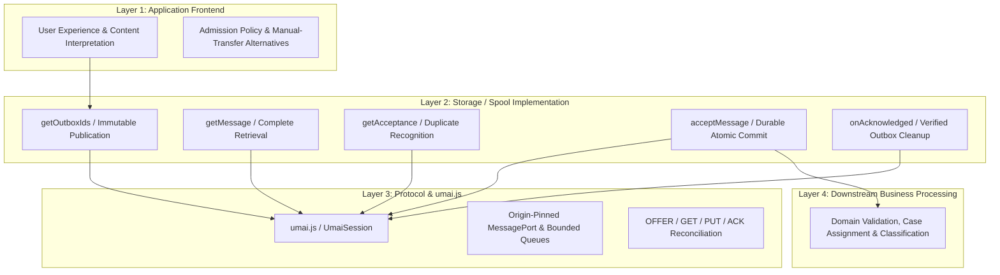

# Developer Integration Guide: Integrating Applications with UMAI

**How to connect legacy, enterprise, or modern web applications without server-to-server APIs**

---

## 1. The Core Philosophy of UMAI

Traditional enterprise integration typically requires direct server-to-server communication:
- Complex firewall exceptions and VPN tunnels between corporate networks.
- Mutual TLS certificates, API gateways, and service accounts.
- Heavy middleware (message brokers, iPaaS, ETL pipelines).
- Weeks or months of cross-department security reviews and coordination.

For legacy systems, adding modern server-to-server REST or gRPC APIs is often high-risk, expensive, or impossible.

### The UMAI Alternative: User-Mediated Integration

In enterprise workflows, **the authorized human user is already authenticated to both applications in their browser**:

```text
┌─────────────────────────────────────────────────────────────┐
│                       User's Browser                        │
│                                                             │
│  ┌─────────────────────────┐   ┌─────────────────────────┐  │
│  │  Host Application (B)   │   │ Embedded Application (A)│  │
│  │   (e.g. Accounting)     │   │     (e.g. Legacy ERP)   │  │
│  │                         │   │                         │  │
│  │    [ UMAI Adapter ]     │◄─►│    [ UMAI Adapter ]     │  │
│  └────────────┬────────────┘   └────────────┬────────────┘  │
└───────────────┼─────────────────────────────┼───────────────┘
                │                             │
       (Local HTTP Session)          (Local HTTP Session)
                │                             │
                ▼                             ▼
     ┌─────────────────────┐       ┌─────────────────────┐
     │  App B Server (DB)  │       │  App A Server (DB)  │
     │   (e.g. Internal)   │       │   (e.g. Isolated)   │
     └─────────────────────┘       └─────────────────────┘
         ▲                                     ▲
         │                                     │
         └────── NO DIRECT SERVER CONNECTION ──┘
```

The browser acts as a secure, sandboxed mediator:
1. Applications communicate purely via client-side Web APIs (`postMessage`, `MessageChannel`, Structured Clone).
2. Binary files (`File` / `Blob`) are transferred in-memory with byte-level integrity.
3. Neither server needs public API exposure, inbound ports, or cross-network access.
4. Legacy applications only need to load the in-browser script and connect their existing UI or storage through a simple adapter—without writing any server-to-server APIs.

---

## 2. Architecture: Separation of Concerns

UMAI keeps four responsibilities strictly distinct:



1. **Protocol and `js/umai.js`:** Connection security, bounded protocol processing, reconciliation, transfer coordination, and technical acceptance signaling. Has **zero** DOM knowledge, zero styling, zero framework dependencies, and no knowledge of your server technology.
2. **Application Frontend:** User experience, content interpretation, application-specific admission policy, business workflow, and manual-transfer alternatives (such as oversized-document pickup).
3. **Storage / Spool Implementation (via the 5-Method Adapter):** Independent authorization and technical validation, immutable publication, durable acceptance, integrity verification, and duplicate recognition.
4. **Business Processing (Outside UMAI):** Domain validation, importing into business cases, classification, and subsequent actions—all occurring *after* technical acceptance.

---

## 3. The 5-Method Storage Contract

To integrate an application with UMAI, you provide a JavaScript object implementing five asynchronous methods:

```typescript
interface UmaiStorageAdapter {
  // 1. Returns a list of pending message IDs waiting in the local outbox
  getOutboxIds(): Promise<string[]>;

  // 2. Returns the complete message payload, native File objects, and optional server signature (Rule 3).
  // Retrieval is all-or-nothing: return null ONLY when the message no longer exists in the outbox;
  // if metadata or ANY attachment fails to load completely, throw an error rather than returning fewer files.
  getMessage(id: string): Promise<{
    id: string;
    payload: any;
    attachments: File[];
    signature?: string; // Optional opaque signature generated by the sending server
  } | null>;

  // 3. Checks a batch of message IDs for durable past acceptance (Rule 5).
  // Must return a plain ID-keyed object containing an explicit { accepted: boolean, ackReceipt?: string }
  // own-property entry for EVERY requested ID in `ids`. If the call throws or ANY requested ID is missing
  // or malformed, the entire batch fails validation (zero ACKs, zero GETs) and retries with capped backoff.
  getAcceptance(ids: string[]): Promise<Record<string, { accepted: boolean; ackReceipt?: string }>>;

  // 4. Atomically commits an incoming complete message, its File attachments, and its durable Accepted Set
  // record (Rules 3 & 4). `umai.js` relies on the adapter fulfilling this durability contract before returning
  // `{ accepted: true, ackReceipt }` (or `true`). Must also handle concurrent or repeated calls for an
  // already-accepted ID idempotently without duplicate import, returning its original `ackReceipt`.
  // Returning `false` / `{ accepted: false }` signals failure and triggers retry/cutoff—never use it as a
  // session-only or non-durable receipt mode.
  acceptMessage(msg: {
    id: string;
    payload: any;
    attachments: File[];
    signature?: string;
  }): Promise<{ accepted: boolean; ackReceipt?: string } | boolean>;

  // 5. Cleans up acknowledged message IDs from the outbox (Rule 6), passing any signed ACK receipts.
  onAcknowledged(ids: string[], receipts?: Record<string, string>): Promise<void>;
}
```

---

## 4. Step-by-Step Integration

### Step 1: Prepare the Embedded Application (e.g. Legacy App A)

If Application A (`https://app-a.company.com`) is embedded inside Application B (`https://app-b.company.org`) via an `<iframe>`:

#### A. Set Content-Security-Policy & Session Cookie Attributes (Server-side)
1. **Allow Application B's specific origin to embed Application A** (avoid wildcards `*`, and ensure any legacy `X-Frame-Options: DENY` or `SAMEORIGIN` header is removed on the embedded route):
   ```http
   Content-Security-Policy: frame-ancestors 'self' https://app-b.company.org;
   ```
2. **Configure Third-Party Session Cookies for Cross-Origin Iframes (CHIPS):**
   Because Application A and Application B run on different domains, modern browsers treat Application A's cookies inside the iframe as third-party cookies. To prevent users from being logged out inside the iframe, Application A must issue its session cookie over HTTPS with `SameSite=None`, `Secure`, and the `Partitioned` attribute (CHIPS — *Cookies Having Independent Partitioned State*):
   ```http
   Set-Cookie: session_token=xyz; Path=/; Secure; HttpOnly; SameSite=None; Partitioned;
   ```

#### B. Include `umai.js` and Initialize the Session
In Application A's web page (preferably placing the initialization script in an external `.js` file such as `/js/app-a-umai.js` so you can enforce a strict `script-src 'self'` Content-Security-Policy without `'unsafe-inline'`):

```html
<script src="/js/umai.js"></script>
<script src="/js/app-a-umai.js"></script>
```

```javascript
// /js/app-a-umai.js
  // 1. Implement the 5 storage methods connecting to your own backend routes.
  //    Note: The paths below (/custom-api/...) illustrate a custom application backend;
  //    see Pattern 4 below for the exact HTTP endpoints exposed by `pkg/umaiserver`.
  const storage = {
    async getOutboxIds() {
      const res = await fetch('/custom-api/outbox/ids');
      if (!res.ok) throw new Error(`Outbox listing failed (${res.status})`);
      return await res.json(); // e.g. ["inv-2026-001"]
    },

    async getMessage(id) {
      const metaRes = await fetch(`/custom-api/outbox/${encodeURIComponent(id)}`);
      if (metaRes.status === 404) return null;
      if (!metaRes.ok) throw new Error(`Outbox metadata fetch failed (${metaRes.status})`);
      const meta = await metaRes.json();

      // Fetch all attachments completely (Rule 3: fail the whole message if any file fetch fails)
      const files = [];
      for (const att of meta.attachments || []) {
        const fileRes = await fetch(
          `/custom-api/outbox/${encodeURIComponent(id)}/files/${encodeURIComponent(att.filename)}`
        );
        if (!fileRes.ok) {
          throw new Error(`Attachment fetch failed for ${att.filename} (${fileRes.status})`);
        }
        const blob = await fileRes.blob();
        if (typeof att.size === 'number' && blob.size !== att.size) {
          throw new Error(`Attachment size mismatch for ${att.filename}`);
        }
        files.push(new File([blob], att.filename));
      }

      return {
        id: meta.id,
        payload: meta.payload,
        attachments: files,
        signature: meta.signature || '' // Passed opaquely if server-side signing is enabled
      };
    },

    async getAcceptance(ids) {
      const res = await fetch('/custom-api/inbox/acceptance', {
        method: 'POST',
        headers: { 'Content-Type': 'application/json' },
        body: JSON.stringify({ ids })
      });
      if (!res.ok) {
        throw new Error(`Acceptance lookup failed (${res.status})`);
      }
      const data = await res.json();
      // Returns { [id]: { accepted: boolean, ackReceipt?: string } } for every requested ID
      return data.results;
    },

    async acceptMessage(msg) {
      const formData = new FormData();
      formData.append('id', msg.id);
      const safePayload = (msg.payload !== undefined && msg.payload !== null) ? msg.payload : {};
      formData.append('payload', JSON.stringify(safePayload));
      if (msg.signature) {
        formData.append('signature', msg.signature);
      }
      for (const file of msg.attachments) {
        formData.append('files', file, file.name);
      }

      const res = await fetch('/custom-api/inbox/accept', { method: 'POST', body: formData });
      if (!res.ok) return { accepted: false };
      const data = await res.json();
      return {
        accepted: Boolean(data.accepted),
        ackReceipt: data.ack_receipt || ''
      };
    },

    async onAcknowledged(ids, receipts) {
      const res = await fetch('/custom-api/outbox/acknowledge', {
        method: 'POST',
        headers: { 'Content-Type': 'application/json' },
        body: JSON.stringify({ ids, receipts })
      });
      if (!res.ok) {
        throw new Error('Failed to acknowledge outbox messages on server');
      }
    }
  };

  // 2. Start UMAI session as embedded peer
  const umai = new UMAI.UmaiSession({
    peerOrigin: 'https://app-b.company.com',
    role: 'embedded',
    storage: storage,
    onStatusChange({ state }) {
      console.log('UMAI status:', state);
    }
  });

  umai.start();
```

---

### Step 2: Prepare the Host Application (e.g. Modern App B)

#### A. Allow the Iframe in Host B's Content-Security-Policy (Server-side)
If Application B serves a `Content-Security-Policy` header, explicitly allow loading frames from Application A's origin (and disallow external sites from framing Host B):
```http
Content-Security-Policy: frame-ancestors 'none'; frame-src 'self' https://app-a.company.com;
```

#### B. Add the Iframe in Your HTML
```html
<iframe id="legacy-app-frame" src="https://app-a.company.com/embedded-view" style="width: 100%; height: 600px; border: 1px solid #ccc;"></iframe>
<script src="/js/umai.js"></script>
<script src="/js/app-b-umai.js"></script>
```

#### C. Initialize `UmaiSession` as Host (`/js/app-b-umai.js`)
```javascript
  const iframeElement = document.getElementById('legacy-app-frame');

  // Implement the same 5-method storage adapter for App B
  const storage = {
    async getOutboxIds() { /* ... */ },
    async getMessage(id) { /* ... */ },
    async getAcceptance(ids) { /* ... */ },
    async acceptMessage(msg) { /* ... */ },
    async onAcknowledged(ids, receipts) { /* ... */ }
  };

  const umai = new UMAI.UmaiSession({
    peerOrigin: 'https://app-a.company.com',
    role: 'host',
    iframe: iframeElement,
    storage: storage,
    onTransfer({ direction, type, id }) {
      console.log(`UMAI Transfer: ${direction} ${type} ${id || ''}`);
    }
  });

  // When iframe loads, start handshake
  iframeElement.addEventListener('load', () => {
    umai.start();
  });
```

---

## 5. Storage Adapter Patterns: Complete Freedom of Implementation

> [!IMPORTANT]
> **UMAI has zero backend requirements.**
> UMAI does not mandate any specific server endpoints, URL routes, databases, or filesystem conventions. The UMAI protocol engine (`umai.js`) lives entirely inside the browser and communicates strictly across window/iframe boundaries via `MessageChannel`.
> 
> How your application feeds messages into the 5-method adapter (`getOutboxIds`, `getMessage`) and how it persists accepted messages (`acceptMessage`) is **entirely up to you**.

Below are six common patterns showing how different applications can implement the 5-method contract:

---

### Pattern 1: Legacy HTML Form & Existing Backend Submission

In many legacy systems, adding brand-new server-to-server APIs is impractical, while the application already has server-rendered HTML pages and form submission handlers. You can read immutable outgoing snapshots from rendered page state and submit incoming messages through an existing server form handler—**provided `ACK` is only emitted after durable server-side persistence**:

```javascript
const legacyFormAdapter = {
  async getOutboxIds() {
    // Only offer an already-snapshotted, immutable record ID rendered by the backend
    const snapshotId = document.getElementById('current-snapshot-id')?.value;
    return snapshotId ? [snapshotId] : [];
  },

  async getMessage(id) {
    const snapshotId = document.getElementById('current-snapshot-id')?.value;
    if (snapshotId !== id) return null;

    const title = document.getElementById('record-title')?.textContent || '';
    const fileInput = document.getElementById('existing-file-upload');
    const files = fileInput && fileInput.files.length > 0 ? Array.from(fileInput.files) : [];

    // Rule 1: Return the immutable payload associated with this snapshot ID
    return {
      id: id,
      payload: { title: title },
      attachments: files
    };
  },

  async getAcceptance(ids) {
    // Query the legacy backend's durable Accepted Set (e.g. a UNIQUE message_id column)
    const res = await fetch('/legacy/check-imported-ids', {
      method: 'POST',
      headers: { 'Content-Type': 'application/json' },
      body: JSON.stringify({ ids })
    });
    if (!res.ok) throw new Error(`Acceptance check failed (${res.status})`);
    return (await res.json()).results;
  },

  async acceptMessage(msg) {
    // Submit complete message + files to the legacy backend's durable import handler.
    // IMPORTANT: Never return `{ accepted: true }` merely for populating unsaved DOM fields!
    const form = document.getElementById('legacy-import-form');
    if (!form) return { accepted: false };

    const data = new FormData();
    data.append('umai_message_id', msg.id);
    data.append('payload_json', JSON.stringify(msg.payload));
    for (const file of msg.attachments) {
      data.append('uploaded_file', file, file.name);
    }

    const response = await fetch(form.action, { method: form.method || 'POST', body: data });
    if (!response.ok) return { accepted: false };
    return { accepted: true };
  },

  async onAcknowledged(ids) {
    // Mark the snapshot as delivered on the backend so it is no longer offered
    const res = await fetch('/legacy/mark-delivered', {
      method: 'POST',
      headers: { 'Content-Type': 'application/json' },
      body: JSON.stringify({ ids })
    });
    if (!res.ok) throw new Error(`Failed marking delivered (${res.status})`);
  }
};
```

> [!WARNING]
> **Preserve the Durable Meaning of `ACK`:**
> Returning `{ accepted: true }` emits `ACK`, authorizing the sender to delete its outgoing copy (Rule 6). Never return `{ accepted: true }` for temporary in-memory DOM pre-fills before the backend has durably saved the message and recorded `msg.id` in its Accepted Set, and avoid relying on browser `localStorage` for production acceptance tracking (clearing browser data or switching devices loses `localStorage` state).

---

### Pattern 2: Offline-First Client-Side Applications (`IndexedDB`)

For genuinely local-first Progressive Web Apps (PWAs) where the browser's `IndexedDB` **is** the application's primary durable store:

- Commit both the incoming message (`payload` + `Blob`/`File` objects) and the Accepted Set entry (`accepted_messages` object store keyed by `id`) inside **a single `readwrite` `IndexedDB` transaction**, resolving `acceptMessage(msg)` with `{ accepted: true }` only inside `tx.oncomplete`.
- Query that same `accepted_messages` object store inside `getAcceptance(ids)`.
- **Operational boundary:** Client-only storage ties both message retention and acceptance records to that specific browser profile. If the user clears site storage, both are lost.
- **Why ad-hoc `showSaveFilePicker` prompts are NOT a valid standalone `acceptMessage` implementation:** Saving files via a one-off browser file picker without recording `msg.id` in a durable Accepted Set breaks Rule 5 deduplication if `ACK` is lost, while returning `false` when a user cancels the picker enters `umai.js` transport failure/retry handling rather than acting as a clean "session-only" mode. If users want to save files to their desktop, accept the message into a durable Incoming Tray first (`ACK`), then offer a normal download/save button in your application UI.

---

### Pattern 3: Hooking into Existing Internal APIs

If your application already has an established internal communication layer—such as:
- Existing GraphQL queries and mutations
- Existing WebSocket or Server-Sent Events (SSE) connections
- Existing internal REST or RPC endpoints

The 5-method adapter simply calls your application's existing client services. No new protocol daemons or specialized endpoints are required.

---

### Pattern 4: Dedicated Internal HTTP Endpoints (Shipped `pkg/umaiserver` Routes)

If you are developing or extending an application backend and want a dedicated set of internal routes matching the UMAI reference server (`pkg/umaiserver`, used by `examples/app-a` and `examples/app-b`), `pkg/umaiserver` exposes:

1. `GET /api/outbox`: Returns pending outbox message objects (`[{ id, ... }]`).
2. `GET /api/outbox/{id}` & `GET /api/outbox/{id}/attachments/{filename}`: Fetches message metadata and streams each attachment to the browser (every attachment declared in metadata must succeed as a complete download before assembling a `PUT`).
3. `POST /api/inbox/acceptance`: Checks a batch of `{ "ids": [...] }` against the durable Accepted Set in one call, returning `{ "results": { [id]: { "accepted": boolean, "ack_receipt"?: string } } }` for every requested ID.
4. `POST /api/inbox`: Receives a `multipart/form-data` upload (`id`, JSON string `payload`, optional `signature`, and `attachments` file parts) and persists it atomically, returning `{ "accepted": true, "ack_receipt": "..." }`.
5. `POST /api/outbox/ack`: Verifies `{ "ids": [...], "receipts": { ... } }` and removes acknowledged messages from the outbox.

> [!NOTE]
> Even in this pattern, these endpoints **only talk to the user's existing, authenticated browser session** via standard internal cookies or headers. They never talk directly to the peer server over the network. Zero firewall rules, zero public exposure, and zero cross-network tunnels.

---

### Pattern 5: Relational Database (SQL) & The "Incoming Tray" Pattern

If your specialty application already uses a relational database (PostgreSQL, MySQL, SQL Server, Oracle, SQLite), **you do not need to write custom filesystem staging or crash-recovery code like `pkg/umaiserver/storage.go`**. A single database transaction with a `UNIQUE` constraint on `umai_message_id` gives you atomic commit (Rule 3), durable acceptance (Rule 4), and idempotent duplicate detection (Rule 5) automatically:

```sql
-- 1. Durable incoming tray table (technical acceptance is decoupled from business case assignment)
CREATE TABLE umai_incoming_tray (
    umai_message_id VARCHAR(128) PRIMARY KEY,
    received_at     TIMESTAMP NOT NULL DEFAULT CURRENT_TIMESTAMP,
    payload_json    JSONB NOT NULL,
    sender_sig      TEXT,
    ack_receipt     TEXT,
    -- Downstream business classification happens AFTER technical ACK:
    assigned_case_id VARCHAR(64) NULL,
    processing_state VARCHAR(32) NOT NULL DEFAULT 'UNASSIGNED'
);
```

When `POST /api/inbox/acceptance` is called by `getAcceptance(ids)`:
1. Execute a single batch query scoped to the authenticated user/tenant/storage identity (e.g., `SELECT umai_message_id, ack_receipt FROM umai_incoming_tray WHERE tenant_id = $1 AND umai_message_id = ANY($2)`).
2. **Only after a complete, successful database query in that correct identity scope**, populate an explicit plain-object entry for **every** requested `id` in `ids`: `{ "accepted": true, "ack_receipt": row.ack_receipt }` for returned rows, and `{ "accepted": false }` for requested IDs absent from the result set. A failed, timed-out, or truncated query MUST return an HTTP `5xx` error (never negative `{ "accepted": false }` entries) so `js/umai.js` backs off and retries safely once the database recovers.

When `POST /api/inbox/accept` is called by `acceptMessage(msg)`:
1. Begin an SQL transaction (`BEGIN`).
2. Verify the sender's cryptographic signature (if enabled) and compute `ack_receipt`.
3. Insert the message and attachments (`INSERT INTO umai_incoming_tray ... ON CONFLICT (umai_message_id) DO NOTHING`) with `processing_state = 'UNASSIGNED'`.
4. Commit the transaction (`COMMIT`) and return `{ "accepted": true, "ack_receipt": "..." }`.
5. Later, a user in your application opens the **Incoming Tray**, reviews the message, and assigns it to a business case or workflow (`UPDATE umai_incoming_tray SET assigned_case_id = ...`).

> [!TIP]
> **Why Separating Technical Acceptance from Business Classification Matters (And How User Approval / Drag-and-Drop Works Above UMAI):**
> Never reject `acceptMessage()` inside the UMAI transport layer just because a business field (like an internal case number) is unknown or needs human review, and do not pause the transport state machine between `OFFER` and `GET` (since `OFFER` carries only opaque IDs, not subjects or metadata).
> Instead, human approval, selective transfer, and drag-and-drop belong cleanly **one layer above UMAI**:
> - **Sender-Side Selection / Drag-and-Drop (Outbox Gating):** Keep draft documents in your normal application storage and only insert a message into the UMAI Outbox (`getOutboxIds()`) when the user clicks *"Send"* or drags-and-drops the item.
> - **Receiver-Side Approval (Incoming Tray Gating):** Let UMAI transfer incoming messages automatically into your durable **Unassigned Incoming Tray** (`acceptMessage` → `ACK`), where your UI has the full verified payload, subject, and attachments and can let the user click *"Import to Case"* or *"Discard"* at their leisure.

---

### Pattern 6: Standalone File-Spool / Sidecar Bridge (Running `pkg/umaiserver` Alongside Your Application)

Many existing specialty or packaged applications already exchange data via local "hot folders" (file spools) or local REST calls and prefer not to add UMAI endpoints directly to their core web application. You can run our Go server (`pkg/umaiserver`) as a **standalone sidecar / file-spool bridge**:

- **How It Works:** Your application embeds `pkg/umaiserver`'s `/sync.html` (or opens it as a companion window) and interacts with `pkg/umaiserver`'s local data directory (`./data/outbox/` and `./data/inbox/`) or localhost HTTP API.
- **Directory Ownership, Direct Filesystem Publication & Inbox Consumption Rules:**
  1. **Collision-Resistant Internal Directory Keys (`m-<sha256(id)>`):** Because valid protocol Message IDs are case-sensitive (`CaseID` vs `caseid`) and may coincide with OS-reserved names on Windows (`CON`, `NUL`, trailing dots), `pkg/umaiserver` stores all messages under collision-resistant internal directory keys `inbox/m-<sha256(id)>/` and `outbox/m-<sha256(id)>/` (`StorageDirKey(id)`), keeping the exact protocol `id` inside `message.json` and verifying `msg.ID == id` on every read.
  2. **Server-Owned Internal Directories (`.staging/` & `.committing/` — Hands Off!):** `.staging/` and `.committing/` inside `dataDir` belong exclusively to `pkg/umaiserver`. On startup (`NewStorage`), the server **deletes `.staging/` completely** and reconciles/cleans `.committing/`. External producers and consumers MUST NEVER stage, read, modify, or delete files inside `.staging/`, `.committing/`, or `accepted.json`.
  3. **Direct Filesystem Publication Contract (`outbox/`):** When an external process publishes an outgoing message:
     - **Via HTTP:** Call `POST /api/docs` + `POST /api/outbox`, which snapshots attachments, computes SHA-256 digests and `UMAI-PUT-V1` signatures, `fsync`s files, and atomically publishes `outbox/m-<sha256(id)>/`.
     - **Direct Filesystem Publication:** Prepare the complete message directory (`attachments/<sanitized_name>` + `message.json` with exact byte sizes, SHA-256 hashes, and required `UMAI-PUT-V1` signature) inside a **separate producer-owned staging directory on the same filesystem** (outside `outbox/`, `inbox/`, `.staging/`, and `.committing/`). Close and `fsync` all files and their parent directories according to your filesystem durability model, verify `outbox/m-<sha256(id)>/` does not already exist (never overwrite or modify a published message in place), publish via a single atomic directory `rename()` into `outbox/m-<sha256(id)>/`, and `fsync(outbox/)`. Only published messages may be offered (`pkg/umaiserver`'s attachment existence and size checks in `ListOutboxForSession` supplement atomic publication; they do not replace it).
  4. **Incoming Messages & Idempotent Inbox Consumption (`inbox/`):**
     - `pkg/umaiserver` commits incoming messages in four stages: `.staging/` → `.committing/m-<sha256(id)>/` → `accepted.json` (`id -> ack_receipt`) + `fsync(dataDir)` → `inbox/m-<sha256(id)>/` + `fsync(inbox/)`. External consumers polling `inbox/` never observe partial or un-flushed commits.
     - Consumers **may archive or delete `inbox/m-<sha256(id)>/` after successful import or deliberate discard**, while leaving `accepted.json` intact so `pkg/umaiserver` continues to recognize the accepted ID and repeat `ACK`s (Rule 5).
     - **Downstream business imports MUST be idempotent by `message.id`:** UMAI deduplicates transport delivery, not distributed transactions in an external business database. If your consumer crashes *after* importing a message into its database *before* deleting `inbox/m-<sha256(id)>/`, the directory will still be present on restart.
     - **Single-Consumer or Atomic Claiming:** Operate either a single inbox consumer process or claim each directory atomically (`rename("inbox/m-<sha256(id)>", "<consumer-processing-dir>/m-<sha256(id)>")` on the same filesystem) before importing so concurrent workers cannot import the same message twice.

---

### Alternative Window Topology: Top-Level Companion / Popup Window (`window.open`)

While embedding a background sync frame (`<iframe>`) is the most seamless UX, some environments or enterprise policies prohibit cross-origin iframes entirely. Because `js/umai.js` runs over a `MessagePort`, you can also connect two **top-level windows** via `window.open` with zero changes to your 5-method storage adapter:

```javascript
// In Host Application B (on user button click):
const companionWin = window.open('https://app-a.company.com/sync.html', 'umai_companion', 'popup,width=460,height=600');

const umai = new UMAI.UmaiSession({
  peerOrigin: 'https://app-a.company.com',
  role: 'host',
  peerWindow: companionWin, // Uses top-level popup instead of an <iframe>!
  storage: storage
});
umai.start();
```
Inside `https://app-a.company.com/sync.html`, `UmaiSession` automatically detects `window.opener` when `window.parent === window` and performs the exact same origin-pinned `READY` → `INIT` (`MessagePort`) → `INIT_ACK` handshake. Because both applications run as top-level windows, **zero third-party or partitioned cookies are required**.

---

## 6. Real-Time Sync State Indicators (Transfer Ongoing vs. Complete Sync)

In production user interfaces, users need clear visual feedback on whether synchronization is actively transferring data or whether both applications are completely in sync.

The `UmaiSession` provides an `onSyncStatus` callback specifically for this purpose:

```javascript
const umai = new UMAI.UmaiSession({
  peerOrigin: 'https://app-a.company.com',
  role: 'host',
  iframe: document.getElementById('legacy-app-frame'),
  storage: myStorageAdapter,
  onSyncStatus({ isSyncing, state, pendingOutgoing, pendingIncoming, detail }) {
    const badge = document.getElementById('sync-indicator');

    if (state !== 'connected') {
      badge.textContent = '⏳ Connecting...';
      badge.className = 'status-connecting';
    } else if (isSyncing) {
      // Transfers are actively ongoing!
      badge.textContent = `🔄 Syncing (${pendingOutgoing} out, ${pendingIncoming} in)...`;
      badge.className = 'status-syncing';
    } else {
      // Complete sync has been reached for now!
      badge.textContent = '🟢 In Sync';
      badge.className = 'status-idle';
    }
  }
});
```

### Event Lifecycle:
1. **Idle State (`isSyncing: false`):** Both sides have empty outboxes or have acknowledged all transfers. The UI displays **`🟢 In Sync`**.
2. **Transfer In-Flight (`isSyncing: true`):** An `OFFER` resulted in a `GET`, and a `PUT` is currently streaming over the `MessageChannel`. The UI displays **`🔄 Syncing...`** with an animated spinner.
3. **Completion:** Upon successful `acceptMessage` and `ACK` receipt, `isSyncing` automatically transitions back to `false`, informing the user that synchronization is complete.

---

## 7. Handling Oversized Documents: Small Notification & Manual Authenticated Pickup

UMAI transfers complete logical messages in memory over a browser `MessagePort` (`50 MiB` default combined payload + attachment limit in `js/umai.js`; `100 MiB` default `MaxUploadSize` in `pkg/umaiserver`). Rather than raising in-memory limits arbitrarily for rare multi-hundred-megabyte or multi-gigabyte files, applications should use the **Small Notification + Manual Authenticated Pickup** pattern:

1. **Transfer Ordinary Messages Directly:** Send standard documents and structured records within configured size limits directly as UMAI messages.
2. **Keep Oversized Files at the Source & Send a Small Notification Message:**
   - Retain the oversized file inside the source application's normal authenticated interface.
   - Publish a small UMAI notification message **with its own distinct Message ID** (and zero binary attachments) whose `payload` describes the available pickup:
     ```json
     {
       "kind": "manual_pickup_available",
       "document_ref": "doc-2026-9941",
       "title": "Site Survey Orthophoto Archive.zip",
       "byte_size": 1845493760,
       "pickup_url": "https://app-a.company.com/cases/9941/downloads/doc-2026-9941"
     }
     ```
3. **`ACK` Confirms the Notification Only — Never Delete the Referenced File on `ACK`:**
   - When the receiving application accepts the notification into its Incoming Tray, the resulting UMAI `ACK` confirms receipt of **the notification message only**.
   - `ACK` does **not** confirm that the user has downloaded or imported the referenced oversized document, and **must never** trigger automatic deletion of the oversized file on the source server.
4. **Security, Snapshot & Lifecycle Boundaries to Keep Explicit:**
   - **Source Authorization Enforced:** Opening `pickup_url` navigates to the source application, which enforces its own normal user authentication and access control before serving the file.
   - **Snapshot & Retention Semantics Belong to the Source Application:** Unlike inline UMAI attachments, a URL/ID reference does not automatically guarantee an immutable byte snapshot or permanent availability unless the source application explicitly snapshots and retains referenced documents according to its own retention policy.
   - **Clear UI State Distinction:** Application UIs should clearly distinguish four distinct states for users:
     1. **Transferred via UMAI** (complete payload and attachments delivered automatically).
     2. **Manual Pickup Available** (notification delivered; user opens the authenticated source link to download/upload the oversized file).
     3. **Unsupported Size** (local outgoing item exceeds the configured UMAI transfer limit and requires manual pickup).
     4. **Transfer Failure** (technical validation, storage, or retry-cutoff error requiring attention).

---

## 8. Browser Security, CSP & Cross-Origin Cookie Checklist

When integrating two applications running on different origins (`https://app-a.company.com` and `https://app-b.company.org`) with separate user authentications, ensure your deployment satisfies these three browser security requirements:

### 1. Content Security Policy (CSP) Configuration
Both applications must explicitly trust the specific peer origin (never use `*`):
- **Host (Application B):** Must allow loading the iframe from Application A:
  ```http
  Content-Security-Policy: frame-ancestors 'none'; frame-src 'self' https://app-a.company.com;
  ```
- **Embedded (Application A):** Must allow being framed by Application B (clickjacking protection) and must not send a conflicting `X-Frame-Options: DENY` or `SAMEORIGIN` header:
  ```http
  Content-Security-Policy: frame-ancestors 'self' https://app-b.company.org;
  ```

### 2. Authentication, Partitioned Cookies (CHIPS) & First-Party Companion Window Fallback
- **Production HTTPS Across Different Domains:** Modern browsers partition or block traditional third-party cookies inside cross-origin iframes. To maintain an authenticated session inside the embedded iframe, Application A should emit its session cookie with `Secure`, `SameSite=None`, and `Partitioned` (CHIPS):
  ```http
  Set-Cookie: session_token=xyz; Path=/; Secure; HttpOnly; SameSite=None; Partitioned;
  ```
- **When Federated Identity Providers (OIDC / SAML / Enterprise SSO) Forbid Framing or Browsers Block Third-Party Cookies:** External identity providers typically set `X-Frame-Options: DENY` and cannot be rendered inside an `<iframe>`, and strict browser privacy settings may block third-party cookies inside iframes altogether. Instead of inventing custom cross-context token-transfer endpoints, switch `UmaiSession` to **First-Party Companion Window Mode**:
  1. On user click ("Open Companion Window"), Host Application B opens `https://app-a.company.com/sync.html?companion=1` (or Application A's top-level workspace) via `const companionWin = window.open(url, 'umai_companion', 'popup,width=440,height=560')` (without `noopener`).
  2. Host Application B binds its `UmaiSession` to that top-level window via `umai.setPeerWindow(companionWin)`.
  3. Inside the companion window, Application A runs in a **first-party top-level context** where standard `SameSite=Lax` cookies and normal OIDC/SAML redirects work out of the box, and `UmaiSession` (`role: 'embedded'`) automatically handshakes with `window.opener` over a dedicated `MessagePort` (implemented in `examples/app-a/static/sync.js`, `examples/app-b/static/minimal.js`, and `examples/app-b/static/app.js`).
- **Local Development on `127.0.0.1` / `localhost` (Strict Origin Equality & RFC 6265 § 8.5):** Browsers and `UmaiSession` treat `http://127.0.0.1:PORT` and `http://localhost:PORT` as distinct `scheme://host:port` origins (`isAllowedOrigin` requires exact origin equality), so always use the same loopback hostname consistently across both apps' URLs and `peerOrigin` configuration. In addition, because browser cookies are not isolated by port number on the same host, use distinct cookie names (e.g. `umai_session_a` and `umai_session_b`) when testing both applications on different ports of `127.0.0.1` or `localhost`.

### 3. Secure Cross-Document Messaging (`postMessage` Origin Pinning)
- **Handled Automatically by `js/umai.js`:** When you pass `peerOrigin` to `new UMAI.UmaiSession({ peerOrigin: 'https://...' })`, `umai.js` automatically:
  1. Passes the exact `peerOrigin` (never `'*'`) as the target origin on every `postMessage` call.
  2. Verifies `event.origin === peerOrigin` and `event.source` (matching `iframe.contentWindow`, `peerWindow`, `window.parent`, or `window.opener`) before processing any handshake message.
  3. Transfers a private `MessageChannel` (`MessagePort`) so all subsequent `OFFER`, `GET`, `PUT`, and `ACK` frames travel over a dedicated point-to-point port rather than the shared `window` event bus.
- **Custom Control Messages:** If your UI sends any custom `window.postMessage` notifications outside `umai.js`, always specify the exact target origin (`iframeWindow.postMessage(data, 'https://app-a.company.com')`) and verify `if (event.origin !== 'https://expected-origin.com') return;` in your listener.

### 4. Protocol Invariants
1. **Rule 1 — Immutability:** Never modify a message once offered. If data changes, generate a new message ID.
2. **Rule 3 — All-or-Nothing Acceptance:** If saving any file fails in `acceptMessage`, return `{ accepted: false }`. Never acknowledge or store a partial message.
3. **Rule 5 — Repeated Acknowledgements:** If `getAcceptance(ids)` returns `{ accepted: true, ackReceipt }` for an offered message ID, UMAI automatically sends `ACK` without re-requesting the message. Ensure your `getAcceptance` method checks persistent storage and returns an explicit `{ accepted: boolean }` entry for every requested ID so accepted IDs survive browser restarts.

---

## 9. Integration Economics & Effort Estimate

When a messaging platform (Application A) provides a ready-to-embed sync endpoint (`/sync.html`), an independently developed specialty application (Application B) with existing document/message tables can typically integrate UMAI in **4–7 developer-days**:

| Specialty Application Task | Typical Implementation | Estimated Effort |
|---|---|---|
| **1. Embed Sync Frame & Status UI** | Embed `<iframe src="https://app-a.example/sync.html">`, set CSP `frame-src`, wire `onSyncStatus` badge. | **0.5 days** |
| **2. Outgoing Adapter (`getOutboxIds`, `getMessage`, `onAcknowledged`)** | Query existing outgoing queue/snapshots and mark records as delivered upon `ACK`. | **1.0 – 2.0 days** |
| **3. Incoming Adapter (`getAcceptance`, `acceptMessage`)** | Query batch acceptance (`WHERE umai_message_id IN (...)`) and insert incoming payload/files into an "Incoming Tray" SQL table with a `UNIQUE` constraint on `umai_message_id`. | **1.0 – 2.0 days** |
| **4. Server-Side Signature & Receipt Verification (Optional)** | Verify `Ed25519` signature on `PUT` and sign `ACK` receipt using standard library crypto. | **0.5 – 1.0 days** |
| **5. End-to-End & Fault Testing** | Verify duplicate suppression, interrupted transfers, and session permissions. | **1.0 – 1.5 days** |
| **Total Specialty Application Effort** | **Zero VPNs, zero mTLS gateways, zero IdP credential sharing.** | **4 – 7 developer-days** |

| Integration Dimension | Conventional Server-to-Server B2B API | UMAI Browser Mediation |
|---|---|---|
| **Network Configuration** | VPNs, NATs, firewall rules, service gateways | Standard HTTPS browsing (`connect-src 'self'`) |
| **Authentication** | Shared mTLS, API keys, OAuth client credentials | Each app uses its own existing user session |
| **Specialty App Effort** | Weeks to months per vendor | **~4–7 developer-days** (5-method adapter) |
| **Data Immutability** | Complex distributed transactions | Built-in 4-message protocol with Rule 5 recovery |
