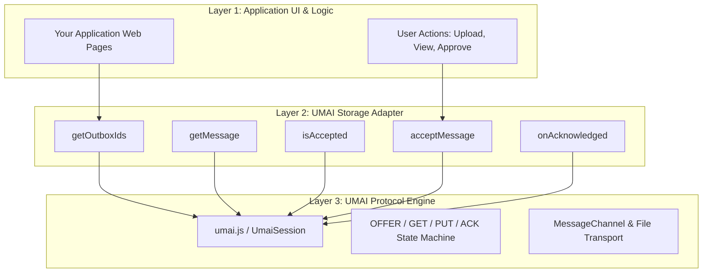

# Developer Integration Guide: Integrating Applications with UMAI

**How to connect legacy, enterprise, or modern web applications without server-to-server APIs**

---

## 1. The Core Philosophy of UMAI

Traditional enterprise integration typically requires direct server-to-server communication:
- Complex firewall exceptions and VPN tunnels between corporate networks.
- Mutual TLS certificates, API gateways, and service accounts.
- Heavy middleware (message brokers, iPaaS, ETL pipelines).
- Weeks or months of cross-department security reviews and coordination.

For legacy systems, adding modern server-to-server REST or gRPC APIs is often high-risk, expensive, or impossible.

### The UMAI Alternative: User-Mediated Integration

In enterprise workflows, **the authorized human user is already authenticated to both applications in their browser**:

```text
┌─────────────────────────────────────────────────────────────┐
│                       User's Browser                        │
│                                                             │
│  ┌─────────────────────────┐   ┌─────────────────────────┐  │
│  │  Host Application (B)   │   │ Embedded Application (A)│  │
│  │   (e.g. Accounting)     │   │     (e.g. Legacy ERP)   │  │
│  │                         │   │                         │  │
│  │    [ UMAI Adapter ]     │◄─►│    [ UMAI Adapter ]     │  │
│  └────────────┬────────────┘   └────────────┬────────────┘  │
└───────────────┼─────────────────────────────┼───────────────┘
                │                             │
       (Local HTTP Session)          (Local HTTP Session)
                │                             │
                ▼                             ▼
     ┌─────────────────────┐       ┌─────────────────────┐
     │  App B Server (DB)  │       │  App A Server (DB)  │
     │   (e.g. Internal)   │       │   (e.g. Isolated)   │
     └─────────────────────┘       └─────────────────────┘
         ▲                                     ▲
         │                                     │
         └────── NO DIRECT SERVER CONNECTION ──┘
```

The browser acts as a secure, sandboxed mediator:
1. Applications communicate purely via client-side Web APIs (`postMessage`, `MessageChannel`, Structured Clone).
2. Binary files (`File` / `Blob`) are transferred in-memory with byte-level integrity.
3. Neither server needs public API exposure, inbound ports, or cross-network access.
4. Legacy applications only need to load the in-browser script and connect their existing UI or storage through a simple adapter—without writing any server-to-server APIs.

---

## 2. Architecture: Separation of Concerns

UMAI is strictly disentangled into three distinct layers:



- **Layer 3 (`js/umai.js`):** Pure, standalone protocol engine. Has **zero** DOM knowledge, zero styling, zero framework dependencies, and no knowledge of your server technology.
- **Layer 2 (The Storage Adapter):** A small 5-method JavaScript object that tells UMAI how your application reads and writes messages.
- **Layer 1 (Application UI):** Your existing user interface (PHP, Java, ASP.NET, Rails, React, Vue, or static HTML).

---

## 3. The 5-Method Storage Contract

To integrate an application with UMAI, you only need to provide a JavaScript object implementing five methods:

```typescript
interface UmaiStorageAdapter {
  // 1. Returns a list of pending message IDs waiting in the local outbox
  getOutboxIds(): Promise<string[]>;

  // 2. Returns the complete message payload, native File objects, and optional server signature
  getMessage(id: string): Promise<{
    id: string;
    payload: any;
    attachments: File[];
    signature?: string; // Optional opaque signature generated by the sending server
  } | null>;

  // 3. Checks whether a message ID has already been accepted in the past (Rule 5).
  // Returns { accepted: boolean, ackReceipt?: string } (or a plain boolean for simple unsigned adapters).
  isAccepted(id: string): Promise<{ accepted: boolean; ackReceipt?: string } | boolean>;

  // 4. Commits an incoming complete message and its File attachments (Rule 3 & 4).
  // Returns { accepted: boolean, ackReceipt?: string } (or a plain boolean for simple unsigned adapters).
  acceptMessage(msg: {
    id: string;
    payload: any;
    attachments: File[];
    signature?: string;
  }): Promise<{ accepted: boolean; ackReceipt?: string } | boolean>;

  // 5. Cleans up acknowledged message IDs from the outbox (Rule 6), passing any signed ACK receipts.
  onAcknowledged(ids: string[], receipts?: Record<string, string>): Promise<void>;
}
```

---

## 4. Step-by-Step Integration

### Step 1: Prepare the Embedded Application (e.g. Legacy App A)

If Application A (`https://app-a.company.com`) is embedded inside Application B (`https://app-b.company.org`) via an `<iframe>`:

#### A. Set Content-Security-Policy & Session Cookie Attributes (Server-side)
1. **Allow Application B's specific origin to embed Application A** (avoid wildcards `*`, and ensure any legacy `X-Frame-Options: DENY` or `SAMEORIGIN` header is removed on the embedded route):
   ```http
   Content-Security-Policy: frame-ancestors 'self' https://app-b.company.org;
   ```
2. **Configure Third-Party Session Cookies for Cross-Origin Iframes (CHIPS):**
   Because Application A and Application B run on different domains, modern browsers treat Application A's cookies inside the iframe as third-party cookies. To prevent users from being logged out inside the iframe, Application A must issue its session cookie over HTTPS with `SameSite=None`, `Secure`, and the `Partitioned` attribute (CHIPS — *Cookies Having Independent Partitioned State*):
   ```http
   Set-Cookie: session_token=xyz; Path=/; Secure; HttpOnly; SameSite=None; Partitioned;
   ```

#### B. Include `umai.js` and Initialize the Session
In Application A's web page (preferably placing the initialization script in an external `.js` file such as `/js/app-a-umai.js` so you can enforce a strict `script-src 'self'` Content-Security-Policy without `'unsafe-inline'`):

```html
<script src="/js/umai.js"></script>
<script src="/js/app-a-umai.js"></script>
```

```javascript
// /js/app-a-umai.js
  // 1. Implement the 5 storage methods connecting to your existing backend.
  //    (Supports both signed/receipt-verified servers like pkg/umaiserver and minimal unsigned endpoints.)
  const storage = {
    async getOutboxIds() {
      const res = await fetch('/api/outbox/ids');
      return await res.json(); // e.g. ["inv-2026-001"]
    },

    async getMessage(id) {
      const meta = await (await fetch(`/api/outbox/${id}`)).json();
      
      // Fetch attachments as native File objects
      const files = [];
      for (const att of meta.attachments) {
        const fileRes = await fetch(`/api/outbox/${id}/files/${att.filename}`);
        const blob = await fileRes.blob();
        files.push(new File([blob], att.filename, { type: blob.type }));
      }

      return {
        id: meta.id,
        payload: meta.payload,
        attachments: files,
        signature: meta.signature || '' // Passed opaquely if server-side signing is enabled
      };
    },

    async isAccepted(id) {
      const res = await fetch(`/api/accepted/check?id=${encodeURIComponent(id)}`);
      const data = await res.json();
      // Return structured { accepted, ackReceipt } object
      return {
        accepted: Boolean(data.accepted),
        ackReceipt: data.ack_receipt || ''
      };
    },

    async acceptMessage(msg) {
      const formData = new FormData();
      formData.append('id', msg.id);
      formData.append('payload', JSON.stringify(msg.payload));
      if (msg.signature) {
        formData.append('signature', msg.signature);
      }
      for (const file of msg.attachments) {
        formData.append('files', file, file.name);
      }

      const res = await fetch('/api/inbox/accept', { method: 'POST', body: formData });
      if (!res.ok) return { accepted: false };
      const data = await res.json().catch(() => ({}));
      return {
        accepted: true,
        ackReceipt: data.ack_receipt || ''
      };
    },

    async onAcknowledged(ids, receipts) {
      const res = await fetch('/api/outbox/acknowledge', {
        method: 'POST',
        headers: { 'Content-Type': 'application/json' },
        body: JSON.stringify({ ids, receipts })
      });
      if (!res.ok) {
        throw new Error('Failed to acknowledge outbox messages on server');
      }
    }
  };

  // 2. Start UMAI session as embedded peer
  const umai = new UMAI.UmaiSession({
    peerOrigin: 'https://app-b.company.com',
    role: 'embedded',
    storage: storage,
    onStatusChange({ state }) {
      console.log('UMAI status:', state);
    }
  });

  umai.start();
```

---

### Step 2: Prepare the Host Application (e.g. Modern App B)

#### A. Allow the Iframe in Host B's Content-Security-Policy (Server-side)
If Application B serves a `Content-Security-Policy` header, explicitly allow loading frames from Application A's origin (and disallow external sites from framing Host B):
```http
Content-Security-Policy: frame-ancestors 'none'; frame-src 'self' https://app-a.company.com;
```

#### B. Add the Iframe in Your HTML
```html
<iframe id="legacy-app-frame" src="https://app-a.company.com/embedded-view" style="width: 100%; height: 600px; border: 1px solid #ccc;"></iframe>
<script src="/js/umai.js"></script>
<script src="/js/app-b-umai.js"></script>
```

#### C. Initialize `UmaiSession` as Host (`/js/app-b-umai.js`)
```javascript
  const iframeElement = document.getElementById('legacy-app-frame');

  // Implement the same 5-method storage adapter for App B
  const storage = {
    async getOutboxIds() { /* ... */ },
    async getMessage(id) { /* ... */ },
    async isAccepted(id) { /* ... */ },
    async acceptMessage(msg) { /* ... */ },
    async onAcknowledged(ids, receipts) { /* ... */ }
  };

  const umai = new UMAI.UmaiSession({
    peerOrigin: 'https://app-a.company.com',
    role: 'host',
    iframe: iframeElement,
    storage: storage,
    onTransfer({ direction, type, id }) {
      console.log(`UMAI Transfer: ${direction} ${type} ${id || ''}`);
    }
  });

  // When iframe loads, start handshake
  iframeElement.addEventListener('load', () => {
    umai.start();
  });
```

---

## 5. Storage Adapter Patterns: Complete Freedom of Implementation

> [!IMPORTANT]
> **UMAI has zero backend requirements.**
> UMAI does not mandate any specific server endpoints, URL routes, databases, or filesystem conventions. The UMAI protocol engine (`umai.js`) lives entirely inside the browser and communicates strictly across window/iframe boundaries via `MessageChannel`.
> 
> How your application feeds messages into the 5-method adapter (`getOutboxIds`, `getMessage`) and how it persists accepted messages (`acceptMessage`) is **entirely up to you**.

Below are four common patterns showing how different applications can implement the 5-method contract:

---

### Pattern 1: DOM & HTML Form Hooking (Zero Backend Changes!)

In many legacy systems, modifying server-side code or deploying new web APIs requires months of bureaucracy. With UMAI, you don't have to touch the backend at all: you can bridge data **directly through the existing HTML DOM and forms**.

#### Outbox: Reading from Existing Page Elements
The user is viewing an invoice or record already rendered on screen. The adapter simply extracts the data from the DOM and grabs the user-selected file:

```javascript
const domStorageAdapter = {
  async getOutboxIds() {
    // If the page has an immutable snapshot ID displayed, treat its ID as the outbox
    const snapshotId = document.getElementById('current-snapshot-id')?.value;
    return snapshotId ? [snapshotId] : [];
  },

  async getMessage(id) {
    const title = document.getElementById('record-title')?.innerText;
    const fileInput = document.getElementById('existing-file-upload');
    const files = fileInput && fileInput.files.length > 0 ? Array.from(fileInput.files) : [];

    // Rule 1: Return the immutable payload associated with this snapshot ID
    return {
      id: id,
      payload: { title: title },
      attachments: files // Native File objects directly from the browser input
    };
  },

  async isAccepted(id) {
    // Illustrative client-side check (production apps should query their backend's durable Accepted Set)
    return { accepted: localStorage.getItem(`accepted_${id}`) !== null };
  },

  async acceptMessage(msg) {
    // INBOX: Populate the legacy app's existing form and submit it!
    const form = document.getElementById('legacy-import-form');
    if (!form) return { accepted: false };

    // Fill hidden or visible input fields
    document.getElementById('import-doc-id').value = msg.id;
    document.getElementById('import-payload-json').value = JSON.stringify(msg.payload);

    // Or submit via classic FormData to the legacy system's existing handler
    const data = new FormData(form);
    for (const file of msg.attachments) {
      data.append('uploaded_file', file, file.name);
    }
    
    const response = await fetch(form.action, { method: form.method || 'POST', body: data });
    if (response.ok) {
      localStorage.setItem(`accepted_${msg.id}`, 'true');
      return { accepted: true };
    }
    return { accepted: false };
  },

  async onAcknowledged(ids) {
    // Show visual checkmark in the legacy UI
    for (const id of ids) {
      const row = document.getElementById(`record-row-${id}`);
      if (row) row.classList.add('synced');
    }
  }
};
```

> [!NOTE]
> **Caveat on Pure Client-Side Acceptance Tracking (`localStorage`):**
> Storing accepted IDs in browser `localStorage` is convenient for rapid prototyping, but if a user clears browser site data or switches computers, `localStorage` is lost. Production integrations should persist accepted Message IDs on the backend (e.g., via a `UNIQUE` column in the legacy form handler or Pattern 5/6 below) so Rule 5 deduplication survives across browsers and machines.

---

### Pattern 2: Pure Client-Side / Offline Storage (IndexedDB or File System)

For offline-first applications, Progressive Web Apps (PWAs), or environments where files should be saved directly to the user's desktop without touching an intermediary application server:

- **Storage via `IndexedDB`:** Incoming messages and binary files (`File` / `Blob`) are stored directly in the browser's persistent client-side database.
- **Direct Local Disk Access (File System Access API):**
  ```javascript
  async function acceptMessage(msg) {
    // Prompt or save directly to a local directory selected by the user
    for (const file of msg.attachments) {
      const handle = await window.showSaveFilePicker({ suggestedName: file.name });
      const writable = await handle.createWritable();
      await writable.write(file);
      await writable.close();
    }
    return true;
  }
  ```

---

### Pattern 3: Hooking into Existing Internal APIs

If your application already has an established internal communication layer—such as:
- Existing GraphQL queries and mutations
- Existing WebSocket or Server-Sent Events (SSE) connections
- Existing internal REST or RPC endpoints

The 5-method adapter simply calls your application's existing client services. No new protocol daemons or specialized endpoints are required.

---

### Pattern 4: Dedicated Internal HTTP Endpoints (Reference Example)

If you *are* developing or extending an application backend and want a clean, dedicated set of internal routes, you can implement lightweight internal endpoints as done in the UMAI reference demo (`examples/app-a` and `examples/app-b`):

1. `GET /api/outbox`: Returns pending message IDs.
2. `GET /api/outbox/{id}` & `/files/{name}`: Fetches metadata and streams attachments to the browser.
3. `POST /api/inbox/accept`: Receives a standard multipart form with files and persists them atomically to your database or document store.
4. `POST /api/outbox/acknowledge`: Marks message IDs as acknowledged.

> [!NOTE]
> Even in this pattern, these endpoints **only talk to the user's existing, authenticated browser session** via standard internal cookies or headers. They never talk directly to the peer server over the network. Zero firewall rules, zero public exposure, and zero cross-network tunnels.

---

### Pattern 5: Relational Database (SQL) & The "Incoming Tray" Pattern

If your specialty application already uses a relational database (PostgreSQL, MySQL, SQL Server, Oracle, SQLite), **you do not need to write custom filesystem staging or crash-recovery code like `pkg/umaiserver/storage.go`**. A single database transaction with a `UNIQUE` constraint on `umai_message_id` gives you atomic commit (Rule 3), durable acceptance (Rule 4), and idempotent duplicate detection (Rule 5) automatically:

```sql
-- 1. Durable incoming tray table (technical acceptance is decoupled from business case assignment)
CREATE TABLE umai_incoming_tray (
    umai_message_id VARCHAR(128) PRIMARY KEY,
    received_at     TIMESTAMP NOT NULL DEFAULT CURRENT_TIMESTAMP,
    payload_json    JSONB NOT NULL,
    sender_sig      TEXT,
    ack_receipt     TEXT,
    -- Downstream business classification happens AFTER technical ACK:
    assigned_case_id VARCHAR(64) NULL,
    processing_state VARCHAR(32) NOT NULL DEFAULT 'UNASSIGNED'
);
```

When `POST /api/inbox/accept` is called by `acceptMessage(msg)`:
1. Begin an SQL transaction (`BEGIN`).
2. Verify the sender's cryptographic signature (if enabled) and compute `ack_receipt`.
3. Insert the message and attachments (`INSERT INTO umai_incoming_tray ... ON CONFLICT (umai_message_id) DO NOTHING`) with `processing_state = 'UNASSIGNED'`.
4. Commit the transaction (`COMMIT`) and return `{ "accepted": true, "ack_receipt": "..." }`.
5. Later, a user in your application opens the **Incoming Tray**, reviews the message, and assigns it to a business case or workflow (`UPDATE umai_incoming_tray SET assigned_case_id = ...`).

> [!TIP]
> **Why Separating Technical Acceptance from Business Classification Matters (And How User Approval / Drag-and-Drop Works Above UMAI):**
> Never reject `acceptMessage()` inside the UMAI transport layer just because a business field (like an internal case number) is unknown or needs human review, and do not pause the transport state machine between `OFFER` and `GET` (since `OFFER` carries only opaque IDs, not subjects or metadata).
> Instead, human approval, selective transfer, and drag-and-drop belong cleanly **one layer above UMAI**:
> - **Sender-Side Selection / Drag-and-Drop (Outbox Gating):** Keep draft documents in your normal application storage and only insert a message into the UMAI Outbox (`getOutboxIds()`) when the user clicks *"Send"* or drags-and-drops the item.
> - **Receiver-Side Approval (Incoming Tray Gating):** Let UMAI transfer incoming messages automatically into your durable **Unassigned Incoming Tray** (`acceptMessage` → `ACK`), where your UI has the full verified payload, subject, and attachments and can let the user click *"Import to Case"* or *"Discard"* at their leisure.

---

### Pattern 6: Standalone File-Spool / Sidecar Bridge (Running `pkg/umaiserver` Alongside Your Application)

Many existing specialty or packaged applications already exchange data via local "hot folders" (file spools) or local REST calls and prefer not to add UMAI endpoints directly to their core web application. You can run our Go server (`pkg/umaiserver`) as a **standalone sidecar / file-spool bridge**:

- **How It Works:** Your application embeds `pkg/umaiserver`'s `/sync.html` (or opens it as a companion window) and interacts with `pkg/umaiserver`'s local data directory (`./data/outbox/` and `./data/inbox/`) or localhost HTTP API.
- **Preventing Partial-Read / Partial-Write Race Conditions on the File Spool:**
  1. **Incoming Messages (`inbox/{id}/`):** `pkg/umaiserver` stages all incoming attachments and `message.json` inside a hidden `.staging/` directory (`O_EXCL` + `fsync`), verifies the `Ed25519` signature, and only then executes an **atomic directory `rename()`** into `inbox/{id}/`. Consequently, any external process polling `inbox/` never observes a partially written message directory. Even if your external consumer archives or deletes `inbox/{id}/` after importing it into your database, `pkg/umaiserver` persists `accepted.json` and `accepted_receipts.json` separately so Rule 5 repeated `ACK` receipts remain durable across restarts.
  2. **Outgoing Messages (`outbox/{id}/`):** When your external process creates an outgoing message on disk, either call `POST /api/docs` + `POST /api/outbox` (which stages, signs, and renames atomically) **or** stage the directory inside `.staging/` first (writing all files in `attachments/` and `message.json` before atomically `rename()`-ing the completed directory into `outbox/{id}/`). As an additional safeguard, `pkg/umaiserver` verifies that `message.json` is valid and that every listed attachment exists on disk with its exact declared byte size before offering the message ID via `OFFER`.

---

### Alternative Window Topology: Top-Level Companion / Popup Window (`window.open`)

While embedding a background sync frame (`<iframe>`) is the most seamless UX, some environments or enterprise policies prohibit cross-origin iframes entirely. Because `js/umai.js` runs over a `MessagePort`, you can also connect two **top-level windows** via `window.open` with zero changes to your 5-method storage adapter:

```javascript
// In Host Application B (on user button click):
const companionWin = window.open('https://app-a.company.com/sync.html', 'umai_companion', 'popup,width=460,height=600');

const umai = new UMAI.UmaiSession({
  peerOrigin: 'https://app-a.company.com',
  role: 'host',
  peerWindow: companionWin, // Uses top-level popup instead of an <iframe>!
  storage: storage
});
umai.start();
```
Inside `https://app-a.company.com/sync.html`, `UmaiSession` automatically detects `window.opener` when `window.parent === window` and performs the exact same origin-pinned `READY` → `INIT` (`MessagePort`) → `INIT_ACK` handshake. Because both applications run as top-level windows, **zero third-party or partitioned cookies are required**.

---

## 6. Real-Time Sync State Indicators (Transfer Ongoing vs. Complete Sync)

In production user interfaces, users need clear visual feedback on whether synchronization is actively transferring data or whether both applications are completely in sync.

The `UmaiSession` provides an `onSyncStatus` callback specifically for this purpose:

```javascript
const umai = new UMAI.UmaiSession({
  peerOrigin: 'https://app-a.company.com',
  role: 'host',
  iframe: document.getElementById('legacy-app-frame'),
  storage: myStorageAdapter,
  onSyncStatus({ isSyncing, state, pendingOutgoing, pendingIncoming, detail }) {
    const badge = document.getElementById('sync-indicator');

    if (state !== 'connected') {
      badge.textContent = '⏳ Connecting...';
      badge.className = 'status-connecting';
    } else if (isSyncing) {
      // Transfers are actively ongoing!
      badge.textContent = `🔄 Syncing (${pendingOutgoing} out, ${pendingIncoming} in)...`;
      badge.className = 'status-syncing';
    } else {
      // Complete sync has been reached for now!
      badge.textContent = '🟢 In Sync';
      badge.className = 'status-idle';
    }
  }
});
```

### Event Lifecycle:
1. **Idle State (`isSyncing: false`):** Both sides have empty outboxes or have acknowledged all transfers. The UI displays **`🟢 In Sync`**.
2. **Transfer In-Flight (`isSyncing: true`):** An `OFFER` resulted in a `GET`, and a `PUT` is currently streaming over the `MessageChannel`. The UI displays **`🔄 Syncing...`** with an animated spinner.
3. **Completion:** Upon successful `acceptMessage` and `ACK` receipt, `isSyncing` automatically transitions back to `false`, informing the user that synchronization is complete.

---

## 7. Browser Security, CSP & Cross-Origin Cookie Checklist

When integrating two applications running on different origins (`https://app-a.company.com` and `https://app-b.company.org`) with separate user authentications, ensure your deployment satisfies these three browser security requirements:

### 1. Content Security Policy (CSP) Configuration
Both applications must explicitly trust the specific peer origin (never use `*`):
- **Host (Application B):** Must allow loading the iframe from Application A:
  ```http
  Content-Security-Policy: frame-ancestors 'none'; frame-src 'self' https://app-a.company.com;
  ```
- **Embedded (Application A):** Must allow being framed by Application B (clickjacking protection) and must not send a conflicting `X-Frame-Options: DENY` or `SAMEORIGIN` header:
  ```http
  Content-Security-Policy: frame-ancestors 'self' https://app-b.company.org;
  ```

### 2. Authentication, Partitioned Cookies (CHIPS) & First-Party Companion Window Fallback
- **Production HTTPS Across Different Domains:** Modern browsers partition or block traditional third-party cookies inside cross-origin iframes. To maintain an authenticated session inside the embedded iframe, Application A should emit its session cookie with `Secure`, `SameSite=None`, and `Partitioned` (CHIPS):
  ```http
  Set-Cookie: session_token=xyz; Path=/; Secure; HttpOnly; SameSite=None; Partitioned;
  ```
- **When Federated Identity Providers (OIDC / SAML / Enterprise SSO) Forbid Framing or Browsers Block Third-Party Cookies:** External identity providers typically set `X-Frame-Options: DENY` and cannot be rendered inside an `<iframe>`, and strict browser privacy settings may block third-party cookies inside iframes altogether. Instead of inventing custom cross-context token-transfer endpoints, switch `UmaiSession` to **First-Party Companion Window Mode**:
  1. On user click ("Open Companion Window"), Host Application B opens `https://app-a.company.com/sync.html?companion=1` (or Application A's top-level workspace) via `const companionWin = window.open(url, 'umai_companion', 'popup,width=440,height=560')` (without `noopener`).
  2. Host Application B binds its `UmaiSession` to that top-level window via `umai.setPeerWindow(companionWin)`.
  3. Inside the companion window, Application A runs in a **first-party top-level context** where standard `SameSite=Lax` cookies and normal OIDC/SAML redirects work out of the box, and `UmaiSession` (`role: 'embedded'`) automatically handshakes with `window.opener` over a dedicated `MessagePort` (implemented in `examples/app-a/static/sync.js`, `examples/app-b/static/minimal.js`, and `examples/app-b/static/app.js`).
- **Local Development on `127.0.0.1` / `localhost` (RFC 6265 § 8.5):** Because browser cookies are not isolated by port number on the same IP, if you test both applications locally on `127.0.0.1:8081` and `127.0.0.1:8082`, use distinct cookie names (e.g. `umai_session_a` and `umai_session_b`) so logging into one port does not overwrite the other port's cookie.

### 3. Secure Cross-Document Messaging (`postMessage` Origin Pinning)
- **Handled Automatically by `js/umai.js`:** When you pass `peerOrigin` to `new UMAI.UmaiSession({ peerOrigin: 'https://...' })`, `umai.js` automatically:
  1. Passes the exact `peerOrigin` (never `'*'`) as the target origin on every `postMessage` call.
  2. Verifies `event.origin === peerOrigin` and `event.source` (matching `iframe.contentWindow`, `peerWindow`, `window.parent`, or `window.opener`) before processing any handshake message.
  3. Transfers a private `MessageChannel` (`MessagePort`) so all subsequent `OFFER`, `GET`, `PUT`, and `ACK` frames travel over a dedicated point-to-point port rather than the shared `window` event bus.
- **Custom Control Messages:** If your UI sends any custom `window.postMessage` notifications outside `umai.js`, always specify the exact target origin (`iframeWindow.postMessage(data, 'https://app-a.company.com')`) and verify `if (event.origin !== 'https://expected-origin.com') return;` in your listener.

### 4. Protocol Invariants
1. **Rule 1 — Immutability:** Never modify a message once offered. If data changes, generate a new message ID.
2. **Rule 3 — All-or-Nothing Acceptance:** If saving any file fails in `acceptMessage`, return `{ accepted: false }`. Never acknowledge or store a partial message.
3. **Rule 5 — Repeated Acknowledgements:** If `isAccepted(id)` returns `{ accepted: true, ackReceipt }` for an offered message, UMAI automatically sends `ACK` without re-requesting the message. Ensure your `isAccepted` method checks persistent storage so accepted IDs survive browser restarts.

---

## 8. Integration Economics & Effort Estimate

When a messaging platform (Application A) provides a ready-to-embed sync endpoint (`/sync.html`), an independently developed specialty application (Application B) with existing document/message tables can typically integrate UMAI in **4–7 developer-days**:

| Specialty Application Task | Typical Implementation | Estimated Effort |
|---|---|---|
| **1. Embed Sync Frame & Status UI** | Embed `<iframe src="https://app-a.example/sync.html">`, set CSP `frame-src`, wire `onSyncStatus` badge. | **0.5 days** |
| **2. Outgoing Adapter (`getOutboxIds`, `getMessage`, `onAcknowledged`)** | Query existing outgoing queue/snapshots and mark records as delivered upon `ACK`. | **1.0 – 2.0 days** |
| **3. Incoming Adapter (`isAccepted`, `acceptMessage`)** | Insert incoming payload and files into an existing "Incoming Tray" SQL table with a `UNIQUE` constraint on `umai_message_id`. | **1.0 – 2.0 days** |
| **4. Server-Side Signature & Receipt Verification (Optional)** | Verify `Ed25519` signature on `PUT` and sign `ACK` receipt using standard library crypto. | **0.5 – 1.0 days** |
| **5. End-to-End & Fault Testing** | Verify duplicate suppression, interrupted transfers, and session permissions. | **1.0 – 1.5 days** |
| **Total Specialty Application Effort** | **Zero VPNs, zero mTLS gateways, zero IdP credential sharing.** | **4 – 7 developer-days** |

| Integration Dimension | Conventional Server-to-Server B2B API | UMAI Browser Mediation |
|---|---|---|
| **Network Configuration** | VPNs, NATs, firewall rules, service gateways | Standard HTTPS browsing (`connect-src 'self'`) |
| **Authentication** | Shared mTLS, API keys, OAuth client credentials | Each app uses its own existing user session |
| **Specialty App Effort** | Weeks to months per vendor | **~4–7 developer-days** (5-method adapter) |
| **Data Immutability** | Complex distributed transactions | Built-in 4-message protocol with Rule 5 recovery |
| **Implementation Effort** | Weeks / Months | An afternoon |
