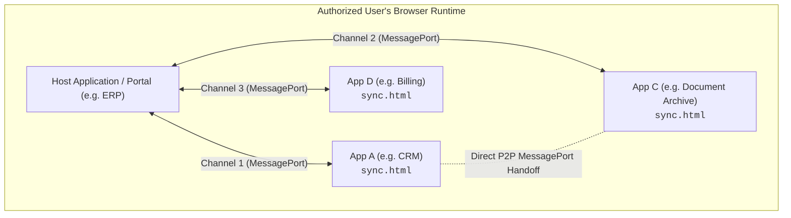
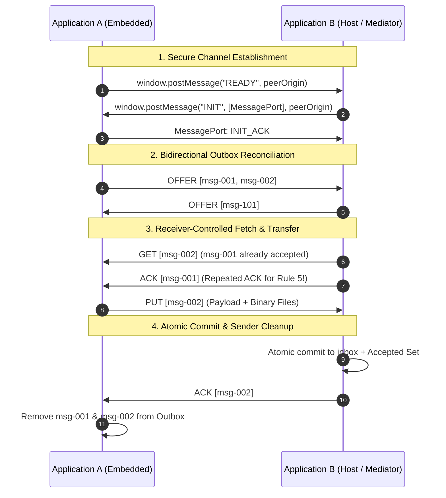

# UMAI 0.1 — User-Mediated Application Interoperability

[](https://golang.org)
[](LICENSE)
[](#)

A minimal, vendor-neutral open-source protocol for exchanging immutable messages and binary attachments between independent web applications directly through an authenticated user's browser.

---

## 1. What UMAI Is

**UMAI** stands for **User-Mediated Application Interoperability** *(and is a nod to the Japanese **うまい** — meaning both "clever / skillful" and "delicious")*.

It enables two completely independent web applications running on different domains to securely exchange structured data and binary files (PDFs, spreadsheets, contracts, images) without requiring direct server-to-server network integrations, API gateways, VPNs, or cloud message brokers.

### Core Characteristics of the UMAI Protocol (`js/umai.js`)
- **Symmetric:** Either application can send and receive simultaneously.
- **Message-Oriented:** Messages consist of structured JSON payloads and native binary attachments.
- **User-Mediated:** Transfers occur exclusively while an authorized user's browser session connects both applications.
- **Zero Cross-Origin HTTP / Zero CORS Required:** Each application's frontend talks exclusively to its own backend. Cross-domain data moves strictly in-memory over a browser `MessagePort`, so neither server ever needs to open CORS (`Access-Control-Allow-Origin`) to the peer domain.
- **Receiver-Controlled:** Receivers inspect offers and decide which messages they need.
- **Resumable & Fault-Tolerant:** Interrupted transfers cleanly resume on subsequent sessions.
- **Application-Agnostic:** Does not dictate business schemas, user authentication mechanisms, or database engines.
- **Opaque Cryptographic Pass-Through:** The `PUT` and `ACK` envelopes natively carry optional opaque `signature` and `receipts` fields so backends can attach end-to-end cryptographic proofs without needing any cryptography in the browser.

### Core Protocol vs. Implementer Choices (What This Repository Demonstrates)

To keep the protocol minimal and adaptable, UMAI cleanly separates **what the protocol itself defines** from **architectural choices left to each implementer** (for which our Go reference server `pkg/umaiserver` provides ready-to-run best-practice examples):

| Layer | Provided by UMAI Core (`js/umai.js` & `SPEC.md`) | Implementer's Choice (Demonstrated as Best Practices in `pkg/umaiserver`) |
|---|---|---|
| **Transport & State Machine** | `READY`/`INIT`/`INIT_ACK` handshake, private `MessagePort`, `OFFER`/`GET`/`PUT`/`ACK` state machine, and the 5-method JS storage adapter. | How the frontend talks to its own backend (REST, GraphQL, WebSockets, or pure client-side IndexedDB). |
| **Authenticity & Integrity** | Carries opaque `signature` (on `PUT`) and `receipts` (on `ACK`) fields through the browser without touching them. | **Recommended Best Practice (Implemented in `pkg/umaiserver`):** Server-side `Ed25519` message signing and signed `ACK` receipt verification so the browser mediator cannot alter messages or forge acknowledgements. |
| **Payload Confidentiality** | Transfers opaque `payload` JSON and binary `File` objects over `MessagePort`. | **Optional Best Practice (Documented in `SECURITY.md`):** Server-to-server asymmetric encryption ("Blind Courier" mode) when the mediating user's browser should not read sensitive data in transit. |
| **Channel Scoping & Multi-User Concurrency** | Guaranteed idempotent reconciliation (Rules 4 & 5) so concurrent deliveries never cause duplicate imports. | **Implementer's Choice (Implemented in `pkg/umaiserver`):** Scoping a channel to *only the logged-in user's messages* vs. pooling *all online users' channels* to transfer system-wide messages (using soft in-flight leases and per-session rotation). |
| **User Authentication & Storage** | Agnostic—operates inside whatever session the user has established in each application. | Production apps use their own IAM (OIDC, SAML, MFA, Passkeys) and databases; `pkg/umaiserver` includes a self-contained demo login and atomic filesystem store for zero-dependency evaluation. |

---

## 2. The Problem It Solves

### The Economic & Workflow Motivation: Eliminating the Mechanical Download/Upload Loop

Across many industries and public-sector ecosystems, a central electronic messaging platform must exchange documents and structured records with dozens of independently developed **specialty applications** (case management, ERP, legal/medical practice software, billing, or document archives).

While high-volume enterprises may invest heavily in custom server-to-server B2B integrations (VPNs, mutual TLS, custom REST/SOAP gateways, and service-account orchestration), building and maintaining direct backend integrations is **disproportionately expensive** for smaller or specialized software vendors. As a result, organizations fall back on manual human workflows:

1. A message or document arrives in **Application A** (e.g., an electronic messaging platform).
2. The user manually downloads the files and attachments to their local disk.
3. The user switches tabs to **Application B** (their specialty application).
4. The user manually uploads the files and re-types the metadata.
5. The user repeats the same manual process in reverse when sending documents out.

Notice that in this workflow, **the human user is already authenticated to both applications and already makes the business decisions** (which documents belong to which case or workflow). What wastes time and introduces errors is the purely mechanical download-and-upload loop.

**The UMAI approach:** Instead of replacing human business judgment or requiring expensive server-to-server infrastructure, UMAI eliminates the mechanical transfer step. Because the user's browser is already connected to both applications, UMAI uses standard Web APIs (`postMessage`, `MessageChannel`, `File` Structured Clone) to reconcile pending outgoing and incoming messages automatically, reliably, and verifiably in the background—complementing conventional B2B APIs at a fraction of the integration cost.

### Asymmetric Integration Economics: "Platform Implements Once, Specialty Apps Integrate in Days"

In a typical hub-and-spoke ecosystem (demonstrated by our [Minimal Production View](#minimal-production-view-zero-distraction-ui)):
- **Application A (Messaging Platform):** Implements UMAI once by providing a lightweight, self-contained embedded sync endpoint (`/sync.html`) that handles its own session management and Federated IdP login bootstrap.
- **Application B (Specialty Application):** The user works primarily inside Application B, which embeds Application A's `/sync.html` frame (or opens it as a companion window) and implements the tiny 5-method storage adapter against its existing database.
- **Strict Separation of Concerns:** Application B remains completely unaware of Application A's authentication internals (OIDC, SAML, MFA, government eID), and UMAI's technical delivery (`ACK`) simply places verified incoming items into Application B's durable **Incoming Tray** so the user can classify or assign them to a business case afterward.
- **Low Integration Cost:** Because the protocol engine (`js/umai.js`) is used verbatim and existing database tables can back the 5-method adapter directly, a typical specialty application can integrate UMAI in **a matter of days rather than weeks or months** (see the detailed engineering breakdown in [`INTEGRATION_GUIDE.md`](INTEGRATION_GUIDE.md#8-integration-economics--effort-estimate)).

### When UMAI Is (and Isn't) the Right Fit

Because UMAI relies on an active browser session to ferry messages between applications (Rule 8), it is important to match the protocol to the right operational profile:

- **Where UMAI Excels:**
  - **Human-in-the-Loop Workflows:** Case management, legal/medical/public-sector correspondence, invoice review, and document filing where a human user already opens Application B during working hours to review, classify, or act on incoming items.
  - **Long-Tail Vendor Ecosystems:** Connecting a central platform to dozens of specialized or legacy applications where bespoke VPNs, mTLS gateways, and service-account orchestration are economically prohibitive.
  - **Standard Document & Record Bundles:** Structured JSON payloads accompanied by typical business attachments (e.g., PDFs, XML/JSON records, spreadsheets, and images up to tens of megabytes per message).
- **When to Use Conventional Server-to-Server APIs Instead:**
  - **Unattended 24/7 Real-Time Alerting or Sub-Second SLAs:** Because **no messages move while no authorized browser session bridges the two applications**, workflows that require guaranteed middle-of-the-night delivery or sub-second machine-to-machine RPC without a human online must use direct server-to-server webhooks or message queues.
  - **High-Throughput Bulk Database Migrations or Multi-Gigabyte Media Streams:** Because `js/umai.js` serializes `PUT` transfers one at a time in browser memory, multi-terabyte backfills or continuous high-frequency telemetry streams belong on dedicated backend pipelines.

### Conceptual Lineage: Browsers as Zero-Install Store-Carry-Forward Couriers

In networking theory, moving data via mobile or intermittent intermediaries is known as **store-carry-forward** or **Delay-Tolerant Networking (DTN, RFC 9171)**—historically seen in offline mesh apps (like Briar or Secure Scuttlebutt) or physical "sneakernets" that require installing specialized native software.

UMAI brings store-carry-forward to **ordinary, logged-in web browser sessions** with zero client installation:
- **Why End-to-End Signing Changes Everything:** Once every message is signed by the server that created it (binding both the sender and the intended receiver in `UMAI-PUT-V1`) and verified by the server that receives it (`UMAI-ACK-V1`), **the transport route stops mattering for integrity**. Whether a record travels over a direct fiber link or is carried across an air-gapped boundary by a user's browser tab, neither the browser nor the route needs to be trusted.
- **Practical Store-Carry-Forward Dynamics:**
  - *Asynchronous Delivery:* Messages move when an authorized user session connects the systems—making UMAI ideal for asynchronous document, invoice, and record synchronization rather than real-time interactive RPC.
  - *Correlated Availability in Multi-User Pools:* While multiple online users provide redundant parallel paths (and UMAI's idempotent `ACK` naturally deduplicates multi-path arrivals), human sessions correlate with working hours, weekends, and holidays.

### Implementer's Choice: User-Scoped vs. System-Wide Opportunistic Pool

Because UMAI leaves backend storage and queuing policy to the implementer, applications can choose how to scope an open UMAI channel depending on their business goal:

1. **Option A — User-Scoped Channel ("My Messages Only"):**
   - The backend filters the outbox and inbox by the authenticated user. Each user's UMAI session only transfers messages belonging to that specific user (or tenant).
2. **Option B — System-Wide Opportunistic Pool ("Crowdsourced System Bridge"):**
   - The backend uses *any* authenticated user's open UMAI channel to transfer **all pending messages** relevant between System A and System B.
   - If 10 users are online simultaneously, the two systems can use all 10 open browser channels in parallel to drain the shared queue.
   - **Best-Practice Hardening Demonstrated in `pkg/umaiserver`:**
     - *Protocol-Level Safety Against Double Efforts:* Even if two browsers transfer the same message concurrently, UMAI's Rule 4 and Rule 5 ensure the receiver commits the message once and returns the stored `ack_receipt` to both.
     - *Server-Side Next-Best Message Selection (Bandwidth-Optimization Lease):* As a best-practice example in `pkg/umaiserver`, fetching an outbox message (`GET /api/outbox/{id}`) places a 15-second soft in-flight lease on it and rotates the unclaimed queue per session. Rather than acting as a hard mutual-exclusion lock, this soft priority hint steers concurrent browsers toward unclaimed messages first to save bandwidth—and if a browser tab closes mid-transfer, the soft lease expires after 15 seconds so another online browser seamlessly takes over.
     - *Server-Side Signing & Optional Encryption:* Combining our reference server's `Ed25519` signing with optional asymmetric encryption ensures a mediating user's browser cannot modify—or even inspect—another user's message while ferrying it.

### Beyond Bilateral: Multi-Server Application Meshes (N ≥ 3)

While the code in this repository demonstrates a bilateral exchange (App A ↔ App B), the UMAI principle is not limited to two systems. Because modern browsers place no logical limit on the number of isolated `<iframe>` contexts or `MessagePort` channels in a tab, a single host application can orchestrate a **multi-server application mesh** connecting 3, 4, or more completely independent backends:



Two distinct multi-server patterns are possible, both built out of standard pairwise (`1:1`) `UmaiSession` links:

1. **Hub-and-Spoke Mesh (Store-and-Forward via Host):**
   - The host application embeds several lightweight sync frames (e.g. CRM, DMS, Billing) and instantiates one standard `UmaiSession` per spoke.
   - Messages from App A destined for App C can be accepted by the host on Channel 1 (`sender: A, receiver: Host`) and queued in the host's outbox for App C on Channel 2 (`sender: Host, receiver: C`).
   - Combining this with **Tier 2 Ed25519 signing** and **Tier 3 Asymmetric Encryption** allows the host to act as a **blind relay**: App A signs an inner end-to-end envelope binding `sender: A, receiver: C` and encrypts it to App C's public key, while the host transfers that opaque ciphertext over its pairwise hop to App C.
2. **Direct Peer-to-Peer Port Handoff:**
   - Because `MessagePort` instances are *transferable objects*, the host can create a `MessageChannel` and transfer `port1` to App A and `port2` to App C via `postMessage`.
   - Once transferred, App A and App C communicate directly across that dedicated pairwise (`A ↔ C`) point-to-point port in browser memory, with `UMAI-PUT-V1` binding `sender: A, receiver: C` directly and zero host interception.

In both patterns, each application continues to communicate strictly with its own same-origin backend (`connect-src 'self'`), preserving the zero-CORS, zero-backend-tunnel security boundary across the entire mesh.

---

## 3. How the Protocol Works

UMAI defines exactly **four** protocol messages:

| Message | Direction | Description |
|---|---|---|
| `OFFER` | Sender → Receiver | Announces available message IDs in the sender's outbox. |
| `GET` | Receiver → Sender | Requests message IDs that have not yet been accepted. |
| `PUT` | Sender → Receiver | Delivers one complete message payload and all associated `File` attachments. |
| `ACK` | Receiver → Sender | Confirms durable acceptance of message IDs. |

### Architectural Flow



---

## 4. Fundamental Rules

1. **Rule 1 — Immutability:** Each message has a globally unique ID. Once created, its metadata and attachment contents are snapshotted and never modified.
2. **Rule 2 — Receiver-Controlled Transfer:** Senders announce availability via `OFFER`; receivers request only unaccepted items via `GET`.
3. **Rule 3 — Complete Messages Only:** Transfers are all-or-nothing. Partial transfers are discarded; interrupted transfers restart from scratch.
4. **Rule 4 — Receiver Acknowledgement:** `ACK` is sent only after files and metadata are verified and committed to durable storage.
5. **Rule 5 — Repeated Acknowledgements:** If a sender offers a message that the receiver has already accepted in a previous session, the receiver immediately sends `ACK` again without requesting a `PUT`. This guarantees outbox cleanup even if earlier network acknowledgements were lost.
6. **Rule 6 — Sender Cleanup:** Senders prune outbox messages once confirmed by `ACK`.
7. **Rule 7 — Reconnection:** Reopening the browser automatically exchanges outstanding offers.
8. **Rule 8 — No Background Autonomy:** No background sync services or daemons run when the browser is closed.

---

## 5. Repository Structure

```text
umai/
├── README.md               # Overview, quickstart, and architecture guide
├── INTEGRATION_GUIDE.md    # Developer guide for integrating legacy & custom apps
├── SPEC.md                 # Formal, vendor-neutral protocol specification
├── SECURITY.md             # Security model, threat analysis, and limitations
├── LICENSE                 # MIT License
├── js/
│   └── umai.js             # Standalone, framework-free JavaScript library
├── pkg/
│   └── umaiserver/         # Shared Go server package (Storage, Auth, HTTP)
├── examples/
│   ├── app-a/              # Independent Go executable (App A, default port 8081)
│   │   ├── main.go
│   │   └── static/         # HTML/CSS/JS frontend
│   └── app-b/              # Independent Go executable (App B, default port 8082, side-by-side host)
│       ├── main.go
│       └── static/         # Host page embedding App A in an iframe
├── tests/
│   ├── storage_test.go     # Go tests for atomic storage, crash recovery, immutability
│   ├── protocol_test.go    # Protocol exchange, binary integrity, duplicate rejection
│   ├── lost_ack_test.go    # Real end-to-end test for repeated-ACK recovery
│   └── umai_js_test.js     # JavaScript unit tests running in Node.js
└── deploy/
    └── Caddyfile.example   # Production reverse-proxy config with HTTPS and CSP
```

---

## 6. Disentangled Architecture & Developer Integration

UMAI is designed so that developers can integrate existing or legacy applications without adopting any frontend frameworks, server frameworks, or server-to-server networking:

1. **Protocol Engine (`js/umai.js`):** Completely decoupled from UI and backend technology. It contains zero HTML, zero CSS, and zero framework code.
2. **The 5-Method Storage Contract:** Any web application connects to `umai.js` by providing five simple asynchronous methods:
   - `getOutboxIds()`
   - `getMessage(id)`
   - `isAccepted(id)`
   - `acceptMessage(msg)`
   - `onAcknowledged(ids)`
3. **Legacy-Friendly:** Zero backend requirements. Legacy applications (PHP, Java, ASP.NET, Rails, static HTML) can bridge data using their existing forms, DOM elements, existing internal APIs, pure client-side storage (IndexedDB), or dedicated internal endpoints. Zero server-to-server APIs required.

👉 **See the complete [Developer Integration Guide](INTEGRATION_GUIDE.md) for architecture patterns, step-by-step code samples, and legacy modernization recipes.**

---

## 7. Getting Started

### Prerequisites
- Go 1.23 or later.
- Modern web browser (Chrome, Safari, Firefox, Edge).
- Optional: Node.js (for running JavaScript test script).

### Running Application A and Application B Locally

In separate terminal tabs (using dedicated local data directories so both applications operate independently):

```bash
# Terminal 1: Start Application A in local demo mode (stores docs & outbox in ./data-a)
go run ./examples/app-a/main.go -demo -addr 127.0.0.1:8081 -peer http://127.0.0.1:8082 -data ./data-a
```

```bash
# Terminal 2: Start Application B in local demo mode (Host, stores docs & outbox in ./data-b)
go run ./examples/app-b/main.go -demo -addr 127.0.0.1:8082 -peer http://127.0.0.1:8081 -data ./data-b
```

Open your browser to:
**`http://127.0.0.1:8082`**

You will see the side-by-side dashboard:
- **Left Column:** Application B (Host)
- **Right Column:** Embedded Application A (via `<iframe>`)

### Demo Authentication
- Default Username: `admin`
- Default Password: `umai123`

*(Both username and password can be customized via flags `-user` and `-pass` or environment variables `UMAI_AUTH_USER` and `UMAI_AUTH_PASS`.)*

### Testing the Exchange
1. Log into Application B on the left panel (`admin` / `umai123`).
2. Log into Application A inside the iframe on the right panel (`admin` / `umai123`).
3. Upload a document in Application A (e.g., `contract.pdf`).
4. In Application A, enter a subject, check the document checkbox, and click **"Create & Queue for Transfer"**.
5. Observe the live protocol activity:
   - Application A sends `OFFER`.
   - Application B recognizes it has not accepted the message and sends `GET`.
   - Application A delivers `PUT` with the native binary file.
   - Application B writes the file atomically, records the accepted ID, and replies with `ACK`.
   - Application A clears the message from its outbox.
   - The document is immediately downloadable under Application B's Inbox!
6. Repeat the reverse flow (B to A) to observe full bidirectional symmetry.

### Minimal Production View (Zero-Distraction UI)
In addition to the dual-inspector view, Application B includes a **minimal single-application view** that demonstrates how UMAI looks in a real enterprise production deployment:

👉 Open **`http://127.0.0.1:8082/minimal.html`**
- **Single-App Workspace:** Application A runs quietly in a background sync frame (`/sync.html`). The user interacts only with Application B.
- **Real-Time Sync Status Indicator:** A live status pill in the header continuously informs the user:
  - 🟢 **`● In Sync`**: Complete sync reached; 0 pending transfers in either direction.
  - 🔄 **`Syncing...`**: Animated real-time spinner showing active in-flight transfers (e.g. `Sending Q4_Audit.pdf...`).
  - 🔒 **`App A Login Required`**: Alerts the user if Application A requires authentication, opening a compact 1-click login drawer without navigating away.
- **One-Click File Transfer:** Select a file, click **"Send & Synchronize"**, and watch it transfer directly to Application A through the browser session!

---

## 8. Running the Test Suite

Execute the complete automated test suite using standard Go tooling:

```bash
# Run all Go unit and protocol integration tests
go test -v ./tests/...
```

Run the JavaScript protocol test runner:

```bash
node tests/umai_js_test.js
```

### The Mandatory Lost-ACK Test
To demonstrate fault tolerance and Rule 5 (repeated acknowledgements), `tests/lost_ack_test.go` executes the following sequence:
1. App A creates a message with binary attachments and transfers it via `PUT` to App B.
2. App B accepts and records the message in its Accepted Set.
3. The initial `ACK` is deliberately suppressed.
4. App A retains the message in its outbox.
5. On the next reconnection, App A re-sends `OFFER` for the same message ID.
6. App B detects that the message ID is already in its Accepted Set.
7. App B sends `ACK` immediately without issuing a `GET` or accepting another `PUT`.
8. App A processes the repeated `ACK` and cleans its outbox.
9. Verification confirms App B has accepted the message **exactly once**.

---

## 9. Security Architecture: Protocol Guarantees vs. Reference Server Best Practices

UMAI clearly separates **what the browser protocol enforces directly** from **server-side best practices** implemented in `pkg/umaiserver`:

### Guaranteed by the UMAI Browser Protocol (`js/umai.js`)
1. **Zero CORS Exposure:** Because Application A's frontend only calls Application A's backend, and Application B's frontend only calls Application B's backend, neither server needs to expose cross-origin CORS headers (`Access-Control-Allow-Origin` / `Access-Control-Allow-Credentials`). All cross-origin exchange happens over a private browser `MessagePort` pinned via `Content-Security-Policy: frame-ancestors`, `event.origin`, and `event.source`.
2. **Receiver-Controlled State Machine:** `js/umai.js` strictly drops any unsolicited `PUT` not preceded by an in-flight `GET` and ignores any `ACK` for unoffered IDs.

### Demonstrated as Server-Side Best Practices (`pkg/umaiserver`)
3. **End-to-End Signed Messages & Signed `ACK` Receipts (`crypto/ed25519`):**
   - UMAI's `PUT` and `ACK` wire schemas provide optional opaque fields (`signature` on `PUT`, and `receipts` on `ACK`) so implementers can verify authenticity server-to-server without browser cryptography.
   - Our reference server (`pkg/umaiserver`) demonstrates this best practice out of the box: the sending server signs the sender role, message ID, canonical JSON payload hash, and attachment SHA-256 digests (`UMAI-PUT-V1`). The receiving server verifies this signature before atomic commit and returns a signed receipt (`UMAI-ACK-V1`), which the sending server verifies before deleting its outbox copy.
4. **Same-Origin CSRF & Endpoint Hardening:**
   - `pkg/umaiserver` demonstrates standard web hardening: same-origin `Origin` header checks on state-changing routes, strict `Content-Type: application/json` enforcement, and keeping pending message IDs restricted to authenticated sessions.
5. **Optional Asymmetric Encryption ("Blind Courier" Mode):**
   - Because `js/umai.js` treats payloads and attachments as opaque objects, implementers who want to hide sensitive content from the mediating browser in transit can encrypt outgoing snapshots on the sending server using the peer server's public key (e.g., `X25519` + `AES-256-GCM`) and decrypt upon inbox ingestion with zero changes to `js/umai.js`.

👉 **See [SECURITY.md](SECURITY.md) for the complete separation of concerns, threat model, and cryptographic specification.**

---

## 10. Production Deployment Behind Caddy

For deployment over the public internet with TLS termination on two separate domains (e.g. `https://app-a.example.org` and `https://app-b.example.net`), `pkg/umaiserver` requires explicit `Ed25519` signing keys and non-default credentials unless `-demo` (or `UMAI_DEMO=1`) is explicitly passed for local loopback evaluation:

1. Copy `deploy/Caddyfile.example` to your Caddy configuration.
2. Start Application A with its private signing key, Peer B's public key, and a strong password:
   ```bash
   UMAI_SIGNING_PRIVATE_KEY="<app-a-ed25519-priv-hex>" \
   UMAI_PEER_PUBLIC_KEY="<app-b-ed25519-pub-hex>" \
   UMAI_AUTH_PASS="<strong-password-a>" \
   ./app-a -addr 127.0.0.1:8081 -peer https://app-b.example.net -data ./data-a
   ```
3. Start Application B with its private signing key, Peer A's public key, and a strong password:
   ```bash
   UMAI_SIGNING_PRIVATE_KEY="<app-b-ed25519-priv-hex>" \
   UMAI_PEER_PUBLIC_KEY="<app-a-ed25519-pub-hex>" \
   UMAI_AUTH_PASS="<strong-password-b>" \
   ./app-b -addr 127.0.0.1:8082 -peer https://app-a.example.org -embed-url https://app-a.example.org -data ./data-b
   ```
4. Caddy automatically provisions Let's Encrypt certificates and enforces the necessary `Content-Security-Policy: frame-ancestors` headers.

---

## 11. Known Limitations

- **Experimental Reference Status:** UMAI 0.1 is an experimental protocol and reference implementation.
- **Third-Party Cookies in Cross-Origin Frames:** Certain strict browser privacy configurations block third-party cookies in iframes. Application A provides a top-level fallback login button for these environments.
- **Single-PUT Concurrency:** To protect browser memory, transfers are serialized one at a time.
- **No Partial File Resumption:** Interrupted transfers are restarted from the beginning.

---

## 12. License

Released under the [MIT License](LICENSE).
