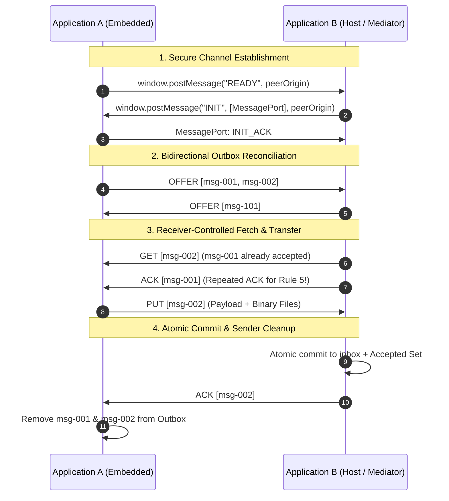

# UMAI 0.1 — User-Mediated Application Interoperability

[](https://golang.org)
[](LICENSE)
[](#)

A minimal, vendor-neutral open-source protocol for exchanging immutable messages and binary attachments between independent web applications directly through an authenticated user's browser.

---

## 1. What UMAI Is

**UMAI** stands for **User-Mediated Application Interoperability**.

It enables two completely independent web applications running on different domains to securely exchange structured data and binary files (PDFs, spreadsheets, contracts, images) without requiring direct server-to-server network integrations, API gateways, VPNs, or cloud message brokers.

### Key Characteristics
- **Symmetric:** Either application can send and receive simultaneously.
- **Message-Oriented:** Messages consist of structured JSON payloads and native binary attachments.
- **User-Mediated:** Transfers occur exclusively while an authorized user's browser session connects both applications.
- **Zero Cross-Origin HTTP / Zero CORS Required:** Each application's frontend talks exclusively to its own backend. Cross-domain data moves strictly in-memory over a browser `MessagePort`, so neither server ever needs to open CORS (`Access-Control-Allow-Origin`) to the peer domain.
- **End-to-End Signed Envelopes & Receipts:** Outbox messages and `ACK` receipts are cryptographically signed and verified server-side (`crypto/ed25519`) while carried as opaque fields (`signature`, `receipts`) by the browser—requiring zero cryptography in the browser.
- **Receiver-Controlled:** Receivers inspect offers and decide which messages they need.
- **Resumable & Fault-Tolerant:** Interrupted transfers cleanly resume on subsequent sessions.
- **Application-Agnostic:** Does not dictate business schemas or database engines.
- **Zero Heavy Infrastructure:** Built using Go standard library, vanilla JavaScript, and native browser primitives.

---

## 2. The Problem It Solves

Modern organizations frequently use separate, siloed web applications (e.g. an ERP on Domain A and a Document Management or Billing System on Domain B). Traditionally, integrating them requires:
- Complex server-to-server REST / gRPC pipelines.
- Direct firewall openings and VPN tunnels between VPCs.
- Shared API keys, mutual TLS certificates, and service accounts.
- Heavy middleware (RabbitMQ, Kafka, Zapier).

**The UMAI approach:** The authorized human user is *already* authenticated to both applications in their browser. By turning the browser tab into a secure mediator via standard Web APIs (`postMessage`, `MessageChannel`, `File` Structured Clone), applications can exchange verified, immutable records and large documents without server-to-server coupling.

### Two Operating Topologies: User-Scoped vs. System-Wide Opportunistic Pool

Depending on an implementation's goals, a UMAI channel can be scoped in two ways:

1. **User-Scoped Channel ("My Messages Only"):**
   - Each user's UMAI session only offers and accepts messages belonging to that specific authenticated user (or tenant).
2. **System-Wide Opportunistic Pool ("Crowdsourced System Bridge"):**
   - Any authenticated user who has both applications open acts as an opportunistic courier for **all pending system-to-system messages** between Application A and Application B.
   - If 10 employees are online simultaneously, the two systems can use all 10 open browser channels in parallel to drain the outbox queue.
   - **Why this is both safe and efficient:**
     - *Cryptographic Integrity & Blind Transit:* Server-side `Ed25519` signing (plus optional asymmetric encryption) ensures a mediating user's browser cannot tamper with—or even read—another user's message while ferrying it.
     - *Withstanding Double Efforts (Idempotency):* Even if two browsers transfer the same message concurrently, Rule 4 and Rule 5 ensure the receiver commits the message once and returns the stored `ack_receipt` to both.
     - *Picking the Next-Best Message (Soft Leases & Session Rotation):* In `pkg/umaiserver`, fetching a message (`GET /api/outbox/{id}`) places a 15-second soft in-flight lease on it and rotates the unclaimed queue per session. Concurrent browsers automatically pick the next unclaimed message rather than duplicating bandwidth, while if a browser tab closes mid-transfer, the soft lease expires and another online user's browser seamlessly takes over.

---

## 3. How the Protocol Works

UMAI defines exactly **four** protocol messages:

| Message | Direction | Description |
|---|---|---|
| `OFFER` | Sender → Receiver | Announces available message IDs in the sender's outbox. |
| `GET` | Receiver → Sender | Requests message IDs that have not yet been accepted. |
| `PUT` | Sender → Receiver | Delivers one complete message payload and all associated `File` attachments. |
| `ACK` | Receiver → Sender | Confirms durable acceptance of message IDs. |

### Architectural Flow



---

## 4. Fundamental Rules

1. **Rule 1 — Immutability:** Each message has a globally unique ID. Once created, its metadata and attachment contents are snapshotted and never modified.
2. **Rule 2 — Receiver-Controlled Transfer:** Senders announce availability via `OFFER`; receivers request only unaccepted items via `GET`.
3. **Rule 3 — Complete Messages Only:** Transfers are all-or-nothing. Partial transfers are discarded; interrupted transfers restart from scratch.
4. **Rule 4 — Receiver Acknowledgement:** `ACK` is sent only after files and metadata are verified and committed to durable storage.
5. **Rule 5 — Repeated Acknowledgements:** If a sender offers a message that the receiver has already accepted in a previous session, the receiver immediately sends `ACK` again without requesting a `PUT`. This guarantees outbox cleanup even if earlier network acknowledgements were lost.
6. **Rule 6 — Sender Cleanup:** Senders prune outbox messages once confirmed by `ACK`.
7. **Rule 7 — Reconnection:** Reopening the browser automatically exchanges outstanding offers.
8. **Rule 8 — No Background Autonomy:** No background sync services or daemons run when the browser is closed.

---

## 5. Repository Structure

```text
umai/
├── README.md               # Overview, quickstart, and architecture guide
├── INTEGRATION_GUIDE.md    # Developer guide for integrating legacy & custom apps
├── SPEC.md                 # Formal, vendor-neutral protocol specification
├── SECURITY.md             # Security model, threat analysis, and limitations
├── LICENSE                 # MIT License
├── js/
│   └── umai.js             # Standalone, framework-free JavaScript library
├── pkg/
│   └── umaiserver/         # Shared Go server package (Storage, Auth, HTTP)
├── examples/
│   ├── app-a/              # Independent Go executable (App A, default port 8081)
│   │   ├── main.go
│   │   └── static/         # HTML/CSS/JS frontend
│   └── app-b/              # Independent Go executable (App B, default port 8082, side-by-side host)
│       ├── main.go
│       └── static/         # Host page embedding App A in an iframe
├── tests/
│   ├── storage_test.go     # Go tests for atomic storage, crash recovery, immutability
│   ├── protocol_test.go    # Protocol exchange, binary integrity, duplicate rejection
│   ├── lost_ack_test.go    # Real end-to-end test for repeated-ACK recovery
│   └── umai_js_test.js     # JavaScript unit tests running in Node.js
└── deploy/
    └── Caddyfile.example   # Production reverse-proxy config with HTTPS and CSP
```

---

## 6. Disentangled Architecture & Developer Integration

UMAI is designed so that developers can integrate existing or legacy applications without adopting any frontend frameworks, server frameworks, or server-to-server networking:

1. **Protocol Engine (`js/umai.js`):** Completely decoupled from UI and backend technology. It contains zero HTML, zero CSS, and zero framework code.
2. **The 5-Method Storage Contract:** Any web application connects to `umai.js` by providing five simple asynchronous methods:
   - `getOutboxIds()`
   - `getMessage(id)`
   - `isAccepted(id)`
   - `acceptMessage(msg)`
   - `onAcknowledged(ids)`
3. **Legacy-Friendly:** Zero backend requirements. Legacy applications (PHP, Java, ASP.NET, Rails, static HTML) can bridge data using their existing forms, DOM elements, existing internal APIs, pure client-side storage (IndexedDB), or dedicated internal endpoints. Zero server-to-server APIs required.

👉 **See the complete [Developer Integration Guide](INTEGRATION_GUIDE.md) for architecture patterns, step-by-step code samples, and legacy modernization recipes.**

---

## 7. Getting Started

### Prerequisites
- Go 1.22 or later.
- Modern web browser (Chrome, Safari, Firefox, Edge).
- Optional: Node.js (for running JavaScript test script).

### Running Application A and Application B Locally

In separate terminal tabs (using dedicated local data directories so both applications operate independently):

```bash
# Terminal 1: Start Application A (stores docs & outbox in ./data-a)
go run ./examples/app-a/main.go -addr 127.0.0.1:8081 -peer http://127.0.0.1:8082 -data ./data-a
```

```bash
# Terminal 2: Start Application B (Host, stores docs & outbox in ./data-b)
go run ./examples/app-b/main.go -addr 127.0.0.1:8082 -peer http://127.0.0.1:8081 -data ./data-b
```

Open your browser to:
**`http://127.0.0.1:8082`**

You will see the side-by-side dashboard:
- **Left Column:** Application B (Host)
- **Right Column:** Embedded Application A (via `<iframe>`)

### Demo Authentication
- Default Username: `admin`
- Default Password: `umai123`

*(Both username and password can be customized via flags `-user` and `-pass` or environment variables `UMAI_AUTH_USER` and `UMAI_AUTH_PASS`.)*

### Testing the Exchange
1. Log into Application B on the left panel (`admin` / `umai123`).
2. Log into Application A inside the iframe on the right panel (`admin` / `umai123`).
3. Upload a document in Application A (e.g., `contract.pdf`).
4. In Application A, enter a subject, check the document checkbox, and click **"Create & Queue for Transfer"**.
5. Observe the live protocol activity:
   - Application A sends `OFFER`.
   - Application B recognizes it has not accepted the message and sends `GET`.
   - Application A delivers `PUT` with the native binary file.
   - Application B writes the file atomically, records the accepted ID, and replies with `ACK`.
   - Application A clears the message from its outbox.
   - The document is immediately downloadable under Application B's Inbox!
6. Repeat the reverse flow (B to A) to observe full bidirectional symmetry.

### Minimal Production View (Zero-Distraction UI)
In addition to the dual-inspector view, Application B includes a **minimal single-application view** that demonstrates how UMAI looks in a real enterprise production deployment:

👉 Open **`http://127.0.0.1:8082/minimal.html`**
- **Single-App Workspace:** Application A runs quietly in a background sync frame (`/sync.html`). The user interacts only with Application B.
- **Real-Time Sync Status Indicator:** A live status pill in the header continuously informs the user:
  - 🟢 **`● In Sync`**: Complete sync reached; 0 pending transfers in either direction.
  - 🔄 **`Syncing...`**: Animated real-time spinner showing active in-flight transfers (e.g. `Sending Q4_Audit.pdf...`).
  - 🔒 **`App A Login Required`**: Alerts the user if Application A requires authentication, opening a compact 1-click login drawer without navigating away.
- **One-Click File Transfer:** Select a file, click **"Send & Synchronize"**, and watch it transfer directly to Application A through the browser session!

---

## 8. Running the Test Suite

Execute the complete automated test suite using standard Go tooling:

```bash
# Run all Go unit and protocol integration tests
go test -v ./tests/...
```

Run the JavaScript protocol test runner:

```bash
node tests/umai_js_test.js
```

### The Mandatory Lost-ACK Test
To demonstrate fault tolerance and Rule 5 (repeated acknowledgements), `tests/lost_ack_test.go` executes the following sequence:
1. App A creates a message with binary attachments and transfers it via `PUT` to App B.
2. App B accepts and records the message in its Accepted Set.
3. The initial `ACK` is deliberately suppressed.
4. App A retains the message in its outbox.
5. On the next reconnection, App A re-sends `OFFER` for the same message ID.
6. App B detects that the message ID is already in its Accepted Set.
7. App B sends `ACK` immediately without issuing a `GET` or accepting another `PUT`.
8. App A processes the repeated `ACK` and cleans its outbox.
9. Verification confirms App B has accepted the message **exactly once**.

---

## 9. Security Architecture & Cryptographic Verification

UMAI separates **in-browser transport mediation** from **server-side cryptographic verification**:

1. **Zero CORS Exposure:** Because Application A's frontend only calls Application A's backend, and Application B's frontend only calls Application B's backend, neither server exposes cross-origin CORS headers (`Access-Control-Allow-Origin` / `Access-Control-Allow-Credentials`). All cross-origin exchange happens over a private browser `MessagePort` pinned via `Content-Security-Policy: frame-ancestors`, `event.origin`, and `event.source`.
2. **State-Machine & CSRF Hardening:**
   - `js/umai.js` strictly enforces receiver-controlled transfers (dropping any unsolicited `PUT` not preceded by an in-flight `GET` and ignoring any `ACK` for unoffered IDs).
   - `pkg/umaiserver` enforces same-origin `Origin` header checks on all state-changing routes, requires `Content-Type: application/json` on JSON endpoints, and never leaks pending message IDs on unauthenticated status endpoints.
3. **End-to-End Signed Messages & Signed `ACK` Receipts (`crypto/ed25519`):**
   - While signing happens server-side, the UMAI `PUT` and `ACK` wire schemas include first-class opaque fields (`signature` on `PUT`, and `receipts` on `ACK`).
   - The sending server signs the canonical message ID, JSON payload hash, and attachment SHA-256 digests (`UMAI-PUT-V1`). The receiving server verifies this signature before atomic commit and returns a signed receipt (`UMAI-ACK-V1`). The sending server verifies the receipt before deleting its outbox copy—preventing browser-level tampering or forged acknowledgements without needing any cryptography in the browser.
4. **Optional Asymmetric Encryption ("Blind Courier" Mode):**
   - Because `js/umai.js` treats payloads and attachments as opaque objects, servers that wish to hide sensitive content from the mediating user's browser or extensions in transit can encrypt outgoing snapshots using the peer server's public key (e.g., `X25519` + `AES-256-GCM`) and decrypt upon inbox ingestion with zero changes to `js/umai.js`.

👉 **See [SECURITY.md](SECURITY.md) for the complete threat model and cryptographic specification.**

---

## 10. Production Deployment Behind Caddy

For deployment over the public internet with TLS termination on two separate domains (e.g. `https://app-a.example.ch` and `https://app-b.example.net`):

1. Copy `deploy/Caddyfile.example` to your Caddy configuration.
2. Start Application A:
   ```bash
   ./app-a -addr 127.0.0.1:8081 -peer https://app-b.example.net
   ```
3. Start Application B:
   ```bash
   ./app-b -addr 127.0.0.1:8082 -peer https://app-a.example.ch -embed-url https://app-a.example.ch
   ```
4. Caddy automatically provisions Let's Encrypt certificates and enforces the necessary `Content-Security-Policy: frame-ancestors` headers.

---

## 11. Known Limitations

- **Experimental Reference Status:** UMAI 0.1 is an experimental protocol and reference implementation.
- **Third-Party Cookies in Cross-Origin Frames:** Certain strict browser privacy configurations block third-party cookies in iframes. Application A provides a top-level fallback login button for these environments.
- **Single-PUT Concurrency:** To protect browser memory, transfers are serialized one at a time.
- **No Partial File Resumption:** Interrupted transfers are restarted from the beginning.

---

## 12. License

Released under the [MIT License](LICENSE).
